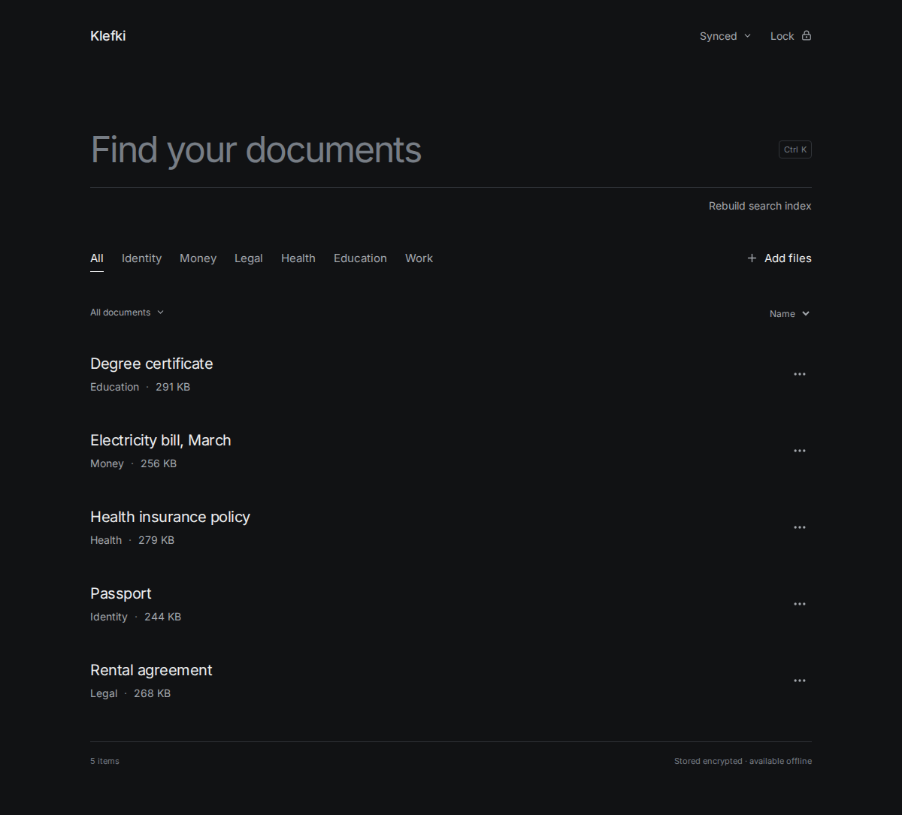
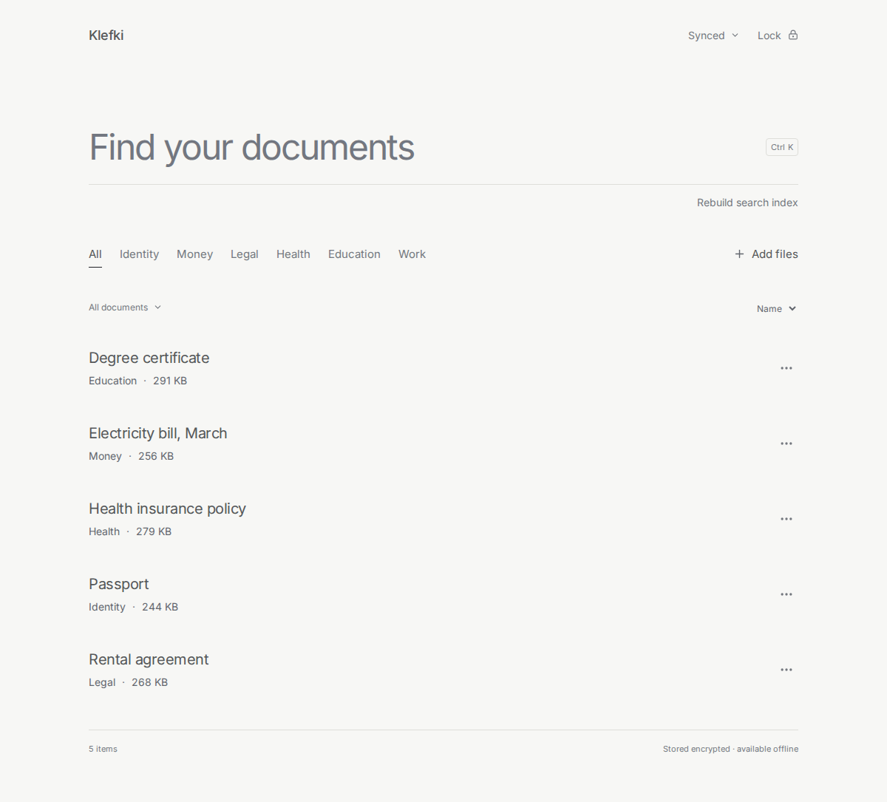
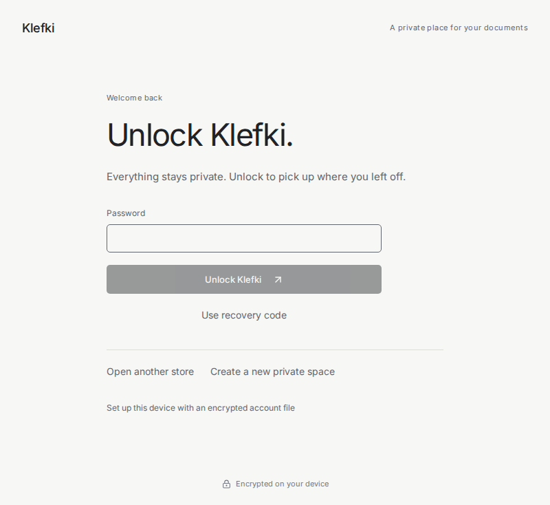

# Klefki

A private home for your documents. Keep IDs, bills, certificates, scans, and
records in one place, available offline and encrypted before they leave your
device. Organize them, search their contents, and carry the same library between
your computers and browser.

## Apps and access

| App | What you can do |
| --- | --- |
| **Desktop: Linux and Windows** | Organize documents, preview PDFs/images/text, use local OCR and search, sync, and manage locking and appearance. Linux also supports fingerprint unlock. |
| **Web: installable PWA** | Upload and download documents, edit names/tags/favorites, create folders, work offline, sync with desktop, and optionally unlock with a compatible passkey. Supported text files up to 1 MiB can be edited in the browser. |
| **CLI** | Encrypt/decrypt individual files, manage a local document store, sync, index/search, run optional document analysis, and create/check/restore backups. |

Desktop and web use compatible encryption formats. The CLI shares the desktop
core and provides tools for automation, recovery, and verification.

## Organize and view documents

- **Folders and tags:** create folders, move documents, rename them, and add custom tags.
- **Categories:** browse Identity, Money, Legal, Health, Education, and Work alongside your own tags.
- **Organize files:** use the local embedding model to match existing or custom tags,
  group unmatched documents, and review editable new tag suggestions before applying.
  [Desktop organizer](docs/organization.md).
- **Favorites:** keep frequently used documents in a dedicated view.
- **Sorting:** sort the desktop library by name, file type, or size.
- **Import:** add files through the desktop picker or drag and drop; uploads show progress and can be canceled.
- **Previews:** read text, view images with zoom, and navigate/zoom PDF pages in the desktop app.
- **Export:** save a decrypted copy to a chosen location; unsupported preview formats can still be exported.
- **Trash and restore:** recover documents and folders from desktop Trash, with an undo action after moving an item there.

## Search and OCR

Find documents by filename, tag, or words inside their contents. Desktop and CLI
extract text locally and use a ranked keyword index; document text is never sent
to a search service.

- Extract selectable text from PDFs and supported text documents.
- Read words in scanned PDFs and PNG/JPEG images using local Tesseract OCR.
- Handle PDFs containing both selectable text and scanned content.
- Index desktop uploads automatically and rebuild missing or stale indexes when needed.
- Rebuild the search index manually, with cancellation and visible indexing feedback.
- Encrypt the index and sync it like a document, so another client can search
  indexed content without repeating OCR.

Web can search synced indexes, but it does not perform OCR or build document
indexes itself. Web uploads retain name/tag search until desktop or CLI indexes
their contents. [Search setup and prerequisites](docs/m7-status.md).

## Optional semantic search and suggestions

For queries that describe what you need rather than repeat exact words, Klefki
can combine keyword search with local semantic similarity.

- **Hybrid search:** combine keyword matches and document embeddings.
- **Category suggestions:** review suggested categories instead of automatically changing your tags.
- **Field suggestions:** review generic dates and currency amounts with their source evidence.
- **Corrections:** confirm or correct suggestions; confirmed category corrections can guide later suggestions.
- **Local model setup:** download checksum-verified public assets or select a verified local bundle.
- **Per-device control:** enable or disable semantic processing separately on each device.

This feature is English-first, runs locally, and is off by default. Documents,
extracted text, queries, and embeddings are not sent to an AI provider. Web runs
local query inference against indexes synced from desktop/CLI. Keyword search
remains available when the feature is disabled or unavailable.

Desktop/CLI inference requires an ONNX-enabled build; web deployments must
provide the model assets before browser activation.

Semantic search is implemented and has passed a public synthetic evaluation;
acceptance on a private document collection is still pending.
[Setup, evaluation, and limits](docs/m8-status.md).

## Offline and multi-device use

Each device keeps its own encrypted local store. Add documents and make edits
without a connection; pending changes remain queued across restarts and sync
when you reconnect.

To connect another device, export the encrypted account file, open it on the
other device, unlock with the same password, and connect to the same sync server.
Register the account once. Desktop and web offer sync controls; the CLI runs
sync on demand.

Server storage is optional: keep the default **Persistent storage**, or enable
**Temporary relay** to remove delivered ciphertext after all linked devices save
it, with at least two devices required. New devices then need an existing device
to sync again. [Temporary relay and free Render setup](docs/temporary-relay.md).

- **Desktop ↔ web:** documents added on either client can be opened on the other after syncing.
- **Durable offline edits:** local changes and their queue entries are saved together.
- **Interrupted uploads:** retry stored ciphertext and upload only chunks the server has not accepted.
- **Conflict copies:** concurrent edits keep both versions; timestamps and upload order do not choose a winner.
- **Authenticated downloads:** incomplete or tampered revisions are rejected before becoming visible or advancing sync progress.
- **Sync feedback:** see connection state, pending changes, and the last completed sync in desktop.
- **Device sessions:** the server API supports listing and revoking active device sessions.

Sync runs while the app is unlocked; it is not a background service for a locked
library. Browser storage can be cleared or evicted, so keep synced copies and
separate backups. [Multi-device setup and protocol](docs/sync-protocol.md).

## Temporary-relay benchmarks

A live Render relay benchmark on **12 October 2026** completed **24 timed
transfers** across synthetic TXT, CSV, PDF, PNG, ZIP, and binary files from
1 KiB to 64 MiB. Every received file matched its source SHA-256 hash.

The same harness and fixtures were run against a local relay on **13 October
2026**. Browser → relay → Go sync core timings, including sync protocol overhead:

| File | Size | Hosted upload | Local upload | Hosted receive | Local receive |
| --- | ---: | ---: | ---: | ---: | ---: |
| TXT | 1 KiB | 5.33s | 0.583s | 4.36s | 0.038s |
| CSV | 64 KiB | 6.00s | 0.562s | 4.48s | 0.036s |
| TXT | 1 MiB | 6.25s | 0.559s | 5.56s | 0.044s |
| Binary | 8 MiB | 9.89s | 0.795s | 8.57s | 0.203s |
| Binary | 32 MiB | 25.51s | 1.553s | 20.21s | 0.631s |
| Binary | 64 MiB | 40.59s | 2.479s | 31.38s | 1.089s |

On the hosted relay, effective throughput at 64 MiB was **1.58 MiB/s upload**
and **2.04 MiB/s receive**. In the reverse direction, a 32 MiB file took 21.80s to upload from
the Go client and 22.82s to receive in the browser.

Reimporting the same ZIP under the same name created two separate document
entries and uploaded another encrypted chunk. Three subsequent syncs without
edits transferred zero file chunks and added no unexpected document revisions.

These measurements cover the hosted browser UI and production Go sync core on
one machine against a warm service with existing account history. Small forward
transfers use the median of two trials; large files and reverse transfers have
one trial each. Timings exclude automatic polling delays and local file import.
Native desktop UI timing, receipt into the already running desktop store, and
relay ciphertext cleanup were not verified in this session.
[Full report, plots, and raw measurements](docs/benchmarks/2026-10-12-relay/README.md).

The local relay reduced the Go no-edit sync median from **3.62s to 0.022s**.
Adding 300 ms to each of 11 sequential requests (10 protocol requests plus one
harness check) raised it to **3.35s**,
supporting accumulated request latency as the main cause of the hosted floor.
All 24 local transfers passed their hash checks. The local sweep used a higher
request burst allowance; a default-limit control also received a 1 KiB file in
0.039s. Browser UI timings include fixed automation waits.
[Local comparison, request traces, and controlled latency results](docs/benchmarks/2026-10-13-local-relay/README.md).

## Security and privacy

Encryption and decryption happen on the client. The server receives encrypted
document content, private metadata, search indexes, and wrapped keys. It cannot
read filenames, folder names, tags, or document text from those records.

- **Password protection:** Argon2id derives keys from the password; authentication and encryption use separate derived keys.
- **Key hierarchy:** a random master key wraps independent file keys; content revisions use fresh file keys and nonces.
- **Authenticated encryption:** XChaCha20-Poly1305 binds records and chunks to their account, file, position, and final-chunk state.
- **Tamper checks:** modified, swapped, missing, truncated, and mixed-revision chunks fail authentication.
- **Private search:** extracted text, indexes, vectors, and saved analysis remain encrypted at rest and during sync.
- **Transport and sessions:** normal server use requires TLS, with scoped device sessions, request limits, and login rate limiting.
- **Sensitive logging:** server request logs omit document contents, credentials, keys, URLs, and request bodies.
- **Local recovery:** a separately saved recovery code can unlock local data without the password; it is not an online password reset.

The security boundary has limits. Opaque IDs, sizes, timing, and sync relationships
remain visible; local SQLite pages are not fully encrypted. Weak passwords can
be guessed offline. A compromised device or web origin can steal secrets while
you use the app. Valid old history, omitted documents, server rollback, and
forked views are not reliably detectable. No independent security audit has
been performed. [Threat model](docs/threat-model.md) · [Encryption format](docs/crypto-spec.md).

## Locking and biometric access

Desktop supports password and recovery-code unlock, manual locking, configurable
inactivity locking, and locking when minimized. Locking clears private views,
previews, and active operations. Keyboard shortcuts focus search (**Ctrl/Cmd K**)
and lock the library (**Ctrl/Cmd Shift L**). Web locks manually or after five
minutes of inactivity and clears active keys and previews.

On Linux, an enrolled fingerprint reader can unlock desktop through `fprintd` and
the system keyring. The reader listens automatically on the lock screen, shows
contact feedback, and keeps password fallback available. Klefki does not enroll
or store fingerprint templates. This is convenience access: apps able to read
an unlocked keyring may also access the stored unlock keys.
[Fingerprint setup and security boundary](docs/fingerprint-linux.md).

Web offers optional passkey unlock using WebAuthn PRF. Enable it after password
unlock in **Klefki settings**; compatible devices can then verify with a
fingerprint, face, or PIN. The browser chooses the verification method. An
encrypted local wrapper protects the document key and sync credential; password
access remains available. Setup requires an HTTPS domain (or `localhost` for
development), a compatible browser/provider, and is saved per browser. Physical
Android acceptance is pending. [Setup and limits](docs/passkey-web.md).

| Light theme | Locked |
| --- | --- |
|  |  |

Desktop offers light, dark, and system themes. Screenshots show the desktop
frontend with sample documents; [screenshot sources](docs/screenshots/README.md).

## Backup, recovery, and portability

The CLI provides a safety net independent of a running sync server:

- **Encrypted backups:** snapshot the local account and store, including folders,
  tags, favorites, trash, conflicts, historical revisions, and pending edits.
- **Verified restore:** authenticate metadata, wrapped keys, and every revision's
  chunks before reporting success, using the password or saved recovery code.
- **Integrity checks:** validate SQLite, revision ancestry, and current/historical
  file chunks, including trashed documents.
- **Plaintext export:** export documents and a metadata manifest for inspection or portability.
- **Standalone files:** encrypt/decrypt individual files without using the sync store.
- **No overwrite:** CLI encryption, decryption, export, and restore refuse existing destinations.

Backups cover the selected local store, not unsynced changes on another device
or the server installation. Sync web changes to desktop/CLI before backing them
up. Keep recovery codes separately; losing both the password and code leaves no
recovery backdoor. Plaintext exports are deliberately unencrypted.
[Backup and restore guide](docs/backup-restore.md).

## Self-hosting and technical foundation

Run your own Go server with SQLite, local ciphertext storage, and Docker/Compose
support. It handles authentication, encrypted records, resumable chunk uploads,
and revision sync. Serve the built web app from the same origin as the API.

The desktop app uses Wails and React; web uses TypeScript, IndexedDB, and a service
worker. Independent Go and TypeScript crypto implementations share test vectors
for interoperability. OCR uses Tesseract and Poppler; optional inference uses a
local ONNX model. [Server setup](docs/server-api.md) · [Builds and verification](docs/development.md).

## Getting started

1. Choose the [desktop app, web app, or CLI](docs/getting-started.md).
2. Create an account and save the recovery code somewhere separate.
3. Add documents and organize your local library.
4. Connect a sync server when you want access from another device.

Installation commands, platform dependencies, and configuration live in the
[documentation](docs/README.md).

## Project status

Core encryption, server, offline sync, desktop, web, backup/recovery, and keyword
search/OCR have recorded acceptance. Optional semantic search is implemented;
private-document acceptance remains open. [Milestones and evidence](MILESTONES.md)
· [Measured achievements](achievements.md).

Klefki currently focuses on one person's library across their devices. Shared
libraries, link sharing, Android and iOS apps, macOS desktop support, broader
vault and folder organization, expiry reminders, emergency access, and local
LLM features are [planned future work](ROADMAP.md). Web does not yet provide desktop PDF previews,
trash management, browser OCR, recovery-code unlock, or backup archives.

## License

Copyright (c) 2026 Indra55. Klefki is licensed under the
[GNU Affero General Public License v3.0](LICENSE) (`AGPL-3.0-only`).

Third-party dependencies and adapted assets retain their own licenses, including
the [fingerprint icon notices](desktop/frontend/public/fingerprint-license.txt).
