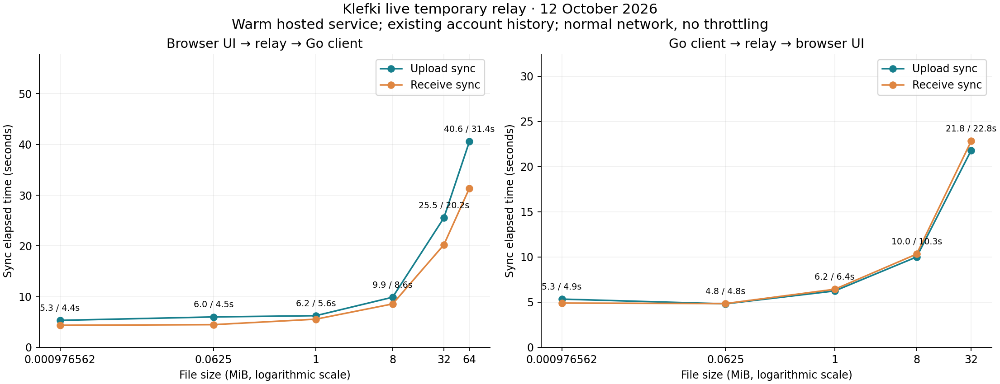
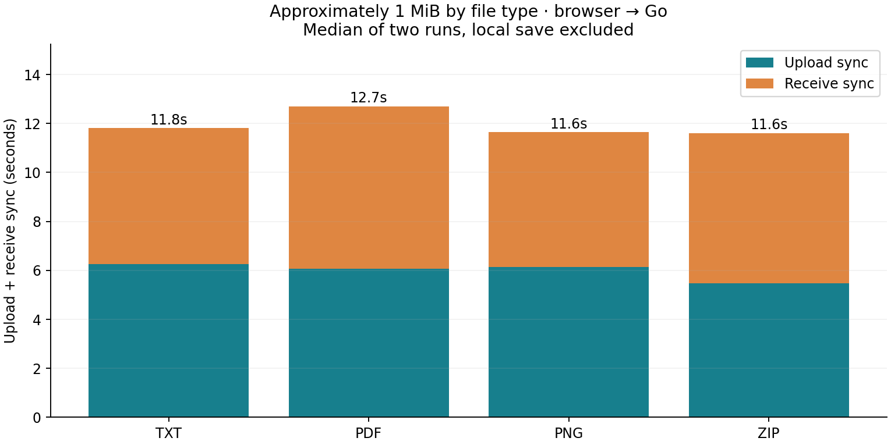

# Live temporary-relay benchmark

Measured 2026-10-12T18:15:38.651Z through 2026-10-12T18:26:23.405Z. Relay: `https://klefki.onrender.com`.

24 timed transfers; 24 exact SHA-256 matches. Source checkout: `bcc4b842003e9655ea7c8bd376bbbb16d5add0c2`. Hosted browser assets: `/assets/index-DeTBR0Gk.js`.

| Direction | File | Size | Runs | Local save | Upload sync | Receive sync | Upload MiB/s | Receive MiB/s |
| --- | --- | ---: | ---: | ---: | ---: | ---: | ---: | ---: |
| Browser → Go | TXT | 1 KiB | 2 | 0.150s | 5.33s | 4.36s | 0.00 | 0.00 |
| Browser → Go | csv | 64 KiB | 2 | 0.170s | 6.00s | 4.48s | 0.01 | 0.01 |
| Browser → Go | TXT | 1.000 MiB | 2 | 0.521s | 6.25s | 5.56s | 0.16 | 0.18 |
| Browser → Go | pdf | 1.000 MiB | 2 | 0.486s | 6.08s | 6.63s | 0.16 | 0.15 |
| Browser → Go | png | 0.998 MiB | 2 | 0.347s | 6.13s | 5.51s | 0.16 | 0.18 |
| Browser → Go | zip | 1.000 MiB | 2 | 0.379s | 5.48s | 6.13s | 0.18 | 0.16 |
| Browser → Go | BIN | 8.000 MiB | 1 | 2.031s | 9.89s | 8.57s | 0.81 | 0.93 |
| Browser → Go | BIN | 32.000 MiB | 1 | 6.831s | 25.51s | 20.21s | 1.25 | 1.58 |
| Browser → Go | BIN | 64.000 MiB | 1 | 1.201s | 40.59s | 31.38s | 1.58 | 2.04 |
| Go → browser | TXT | 1 KiB | 1 | 0.003s | 5.34s | 4.90s | 0.00 | 0.00 |
| Go → browser | csv | 64 KiB | 1 | 0.004s | 4.82s | 4.85s | 0.01 | 0.01 |
| Go → browser | TXT | 1.000 MiB | 1 | 0.014s | 6.24s | 6.43s | 0.16 | 0.16 |
| Go → browser | pdf | 1.000 MiB | 1 | 0.013s | 5.33s | 6.25s | 0.19 | 0.16 |
| Go → browser | png | 0.998 MiB | 1 | 0.019s | 5.72s | 5.79s | 0.17 | 0.17 |
| Go → browser | zip | 1.000 MiB | 1 | 0.009s | 5.65s | 5.52s | 0.18 | 0.18 |
| Go → browser | BIN | 8.000 MiB | 1 | 0.089s | 10.00s | 10.32s | 0.80 | 0.78 |
| Go → browser | BIN | 32.000 MiB | 1 | 0.192s | 21.80s | 22.82s | 1.47 | 1.40 |

## Duplication

- Reimporting the exact same ZIP with the exact same name created **2 separate document entries**, with identical SHA-256 hashes. The second import sent 1 new encrypted chunk(s). This is content reimport behavior; there is no plaintext content deduplication on this path.
- no-edit sync 1: browser 4.53s, Go 3.25s; browser transferred 0 upload / 0 download chunks; Go transferred 0 upload / 0 download chunks.
- no-edit sync 2: browser 4.79s, Go 3.62s; browser transferred 0 upload / 0 download chunks; Go transferred 0 upload / 0 download chunks.
- no-edit sync 3: browser 3.55s, Go 3.76s; browser transferred 0 upload / 0 download chunks; Go transferred 0 upload / 0 download chunks.

## Measurement scope

- Browser measurements use real headless Chromium, the live hosted production website, its file picker, sync UI, IndexedDB and document export. Go measurements use the production `core/sync` implementation and a fresh SQLite store with the same encrypted account. They do **not** time clicking/importing in the installed native desktop UI, native search indexing, or a separate physical device.
- Source and receiver run sequentially on the same machine and connection. Receive times start when the receiving client is explicitly asked to sync; they exclude normal automatic polling delays. Upload + receive is measured client work, not concurrent device latency.
- Local save includes automation file injection, encryption, storage, and the browser row becoming visible. Files up to 32 MiB were injected as buffers, while the 64 MiB file used a file path; these local-save values include different automation overhead and do not isolate encryption speed or a human file-picker experience. Sync timings include inventory, ciphertext verification, chunk transfer, metadata publication/receipt, UI completion and an additional settings request in the Go harness. Browser completion is sampled every 100 ms with 150 ms settling. Throughput is plaintext size divided by full sync elapsed time, rather than raw link bandwidth.
- Browser network metrics omit HTTP/TLS framing. Playwright did not expose Blob upload bodies reliably, so browser request-byte totals are also incomplete. Six request-failed events (`net::ERR_ABORTED`) were observed during successful, hash-verified browser receives, with one chunk GET per one-chunk file rather than retries. These events do not prove a failed transfer. Response-byte totals are incomplete for these requests and must not be used as measured link bandwidth. Browser chunk elapsed times are instrumentation spans, not standalone bandwidth benchmarks. Go transport counts attempts and body bytes. No network throttling was enabled.
- The harness resumed the sweep once after Playwright refused an in-memory file input above 50 MiB. The 64 MiB fixture was then supplied by path; previously completed measurements were kept. Small files have two trials in the browser-to-Go sweep. The 8, 32 and 64 MiB sizes and reverse direction have one trial each. Results describe this live session; they do not estimate long-term percentiles or a concurrency ceiling.
- Fixtures are synthetic: text/CSV, a valid one-page padded PDF, valid random-pixel PNG, ZIP with incompressible data, and random binary payloads. Types do not represent full OCR, preview, indexing or semantic-processing costs. Those optional browser features were not enabled in the benchmark profile.
- The account already had 59 queued revisions. Existing history was downloaded before timed trials. History inventory grows during the sweep, so size and library-growth effects are not fully isolated. The final Go store contained 25 benchmark document heads, matching 25 deliberate imports, and the queue increased by exactly 25; the repeated syncs added no unexpected document revisions.
- The server reported 84 queued revisions after the tests. Existing user devices had not all acknowledged the queue. Ciphertext cleanup was therefore **not proven** by this session; no original device was forgotten to force cleanup.
- Read-only inspection found 0 benchmark files in the already running installed app's local store at the final check. A running process alone does not establish that its vault is unlocked or syncing. Native receipt into that specific store was not demonstrated.
- Both temporary benchmark devices were removed after measurement, and the cleanup read-back confirmed all four original devices remained. Their final outstanding counts were 84, 25, 25, and 84 revisions. The original installed desktop store still had zero benchmark documents at the check.
- The benchmark created only documents named `relaybench-20261012-*`. They remain available locally in the benchmark stores and queued for your existing devices. No preexisting documents were edited or deleted. Temporary benchmark device cleanup is recorded separately in `cleanup.json`.

Raw timing and hashes: [transfers.csv](transfers.csv). Request counts, errors, repeat-sync checks, and relay settings: [results.json](results.json). Private account bytes, passwords, bearer tokens, user-document names and browser screenshots are excluded from these artifacts.

The [local relay comparison](../2026-10-13-local-relay/README.md) reused this harness and its fixtures. The Go no-edit sync median fell from 3.62s to 0.022s; adding 300 ms per sequential request reproduced a 3.35s floor. That report records the request chain, browser automation overhead, and separate default-rate-limit control.
