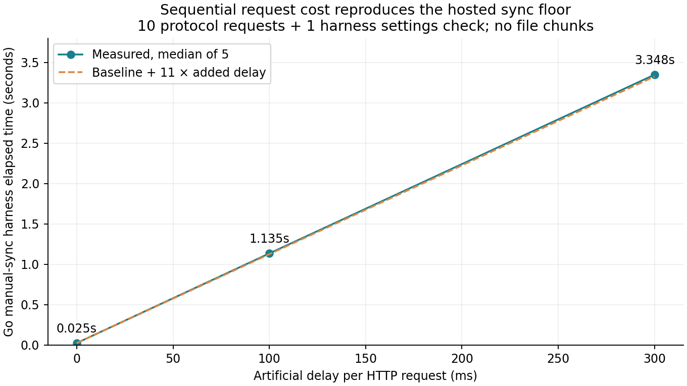
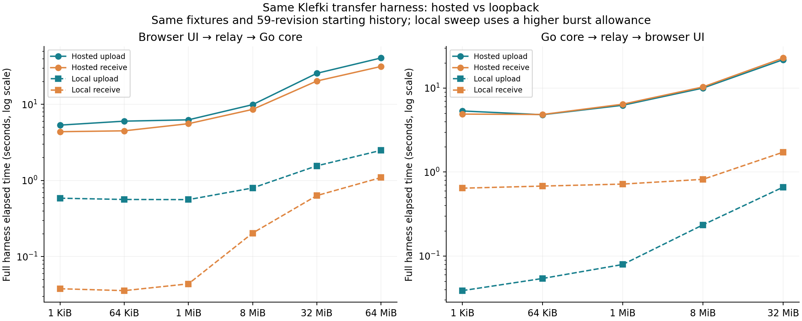

# Local relay comparison

**The Go manual-sync floor dropped from 3.618s hosted to 0.022s on loopback.** Adding 300 ms before each of the same 11 sequential requests raised the local harness to 3.348s, closely reproducing the hosted floor. This supports accumulated request latency as the dominant cost; local processing did not impose a 3–4 second minimum.

Measured 2026-10-12T18:42:22.703Z through 2026-10-12T18:43:36.528Z (13 October 2026 in Asia/Kolkata). Relay: `http://127.0.0.1:5199`. Source: `2d4c5d0cea8551527786c3db99d14b20f6ee8a26`; implementation matches the hosted benchmark revision, with only documentation changes between them. Browser build: `/assets/index-DeTBR0Gk.js`.

24 timed transfers passed SHA-256 checks. The same exact TXT, CSV, PDF, PNG, ZIP, and binary fixtures, sizes, repetitions, browser actions, Go sync path, and UI waits were reused. Original encrypted revision/chunk records seeded a fresh store with 59 revisions; no device identity, remote binding or cursor was copied. Four synthetic offline holding peers kept ciphertext queued as in the hosted account. Their receipt cursors were all zero; the hosted peers had mixed receipts, with the same minimum cursor of zero. Both sweeps ended at 84 queued revisions and 25 deliberate benchmark imports.

## Small-file and no-edit floor

| Measurement | Hosted | Local |
| --- | ---: | ---: |
| 1 KiB browser upload, full UI harness | 5.327s | 0.583s |
| 1 KiB Go receive | 4.364s | 0.038s |
| Go manual sync without edits, median of 3 | 3.618s | 0.022s |
| Browser manual sync without edits, full UI harness, median of 3 | 4.529s | 0.617s |
| Browser foreground request span without edits, median of 3 | Not recorded | 0.116s |

The original browser helper waits 200 ms after clicking Sync now, samples completion every 100 ms, then waits another 150 ms. Playwright also spends time opening and clicking the sync panel. The unchanged UI harness therefore measures about 0.5–0.7s locally even though foreground API spans were 0.070–0.142s. The Go harness has no artificial UI waits. Browser spans run from the first foreground request to the last foreground completion, excluding presence/status polling; they are not native GUI timings or an exact application-function timer.

## Controlled latency

This supplementary probe changes only the benchmark Go HTTP transport: before every request it sleeps for the specified delay. It does not alter the client protocol, production code, or server handlers. Each sample is a no-edit sync plus the original harness settings read, with no chunk transfer or HTTP error response.

| Added delay per request | Sequential requests | Runs | Median elapsed |
| --- | ---: | ---: | ---: |
| 0 ms | 11 | 5 | 0.025s |
| 100 ms | 11 | 5 | 1.135s |
| 300 ms | 11 | 5 | 3.348s |

At zero injected delay, median per-request elapsed time was 1.69 ms. The trace contains:

| Request | Count |
| --- | ---: |
| GET /v1/sync/settings | 2 |
| POST /v1/sync/relay/device | 1 |
| POST /v1/sync/relay/need | 6 |
| GET /v1/sync/changes | 1 |
| PUT /v1/sync/cursor | 1 |

One settings read belongs to the harness after `Client.Sync` returns. The sync implementation itself makes 10 requests in this case. Six `relay/need` calls come from scanning 84 locally retained revisions in pages of 16 (`core/sync/relay.go`). Every full manual sync repeats that scan. Existing automatic polling uses `NeedsSync` to avoid unnecessary full passes, so these counts describe the forced manual-sync path.

## Transfer comparison

| Direction | File | Size | Hosted upload | Local upload | Hosted receive | Local receive |
| --- | --- | ---: | ---: | ---: | ---: | ---: |
| Browser → Go | TXT | 1 KiB | 5.327s | 0.583s | 4.364s | 0.038s |
| Browser → Go | CSV | 64 KiB | 6.002s | 0.562s | 4.481s | 0.036s |
| Browser → Go | TXT | 1.000 MiB | 6.249s | 0.559s | 5.559s | 0.044s |
| Browser → Go | PDF | 1.000 MiB | 6.077s | 0.686s | 6.628s | 0.061s |
| Browser → Go | PNG | 0.998 MiB | 6.134s | 0.659s | 5.512s | 0.047s |
| Browser → Go | ZIP | 1.000 MiB | 5.476s | 0.665s | 6.133s | 0.056s |
| Browser → Go | Binary | 8.000 MiB | 9.891s | 0.795s | 8.567s | 0.203s |
| Browser → Go | Binary | 32.000 MiB | 25.511s | 1.553s | 20.210s | 0.631s |
| Browser → Go | Binary | 64.000 MiB | 40.585s | 2.479s | 31.375s | 1.089s |
| Go → browser | TXT | 1 KiB | 5.339s | 0.039s | 4.900s | 0.643s |
| Go → browser | CSV | 64 KiB | 4.816s | 0.054s | 4.847s | 0.681s |
| Go → browser | TXT | 1.000 MiB | 6.243s | 0.079s | 6.430s | 0.719s |
| Go → browser | PDF | 1.000 MiB | 5.327s | 0.090s | 6.246s | 0.732s |
| Go → browser | PNG | 0.998 MiB | 5.720s | 0.089s | 5.785s | 0.672s |
| Go → browser | ZIP | 1.000 MiB | 5.645s | 0.071s | 5.522s | 0.711s |
| Go → browser | Binary | 8.000 MiB | 10.002s | 0.235s | 10.318s | 0.819s |
| Go → browser | Binary | 32.000 MiB | 21.796s | 0.662s | 22.820s | 1.725s |

## Rate-limit control and limits

- The initial local run used the production default `RateBurst=120`, refilling 120 requests per minute for each IP/request group. Priming 59 revisions hit HTTP 429 and the client's 60-second Retry-After; this setup took 61.21s. Its first successful 1 KiB Go receive still completed in 0.039s with no HTTP error. The run was stopped as the next trial hit throttling.
- The completed burst sweep used `RateBurst=12000` in an isolated server launcher calling the same production `server.Open` and `server.WebHandler`. Queue allowance remained 256 MiB. No production configuration or code was changed. Increasing the budget avoids measuring rate-limit sleeps as protocol processing; the default-rate control independently confirms the small-file floor collapses.
- The local service uses loopback HTTP; the hosted service uses HTTPS and different server resources. This comparison alone does not isolate WAN propagation from hosting/proxy delay. The controlled-delay probe demonstrates the sequential-request multiplier, but it is an artificial request delay, not a packet-level network emulation.
- Small forward files use two trials; larger files and reverse transfers use one. No-edit UI comparisons use three samples; each injected-delay level uses five. Results are session observations, not long-term percentiles, load limits, or native desktop UI performance.
- Source and receiver run sequentially on the same machine. Full harness times include protocol work and completion checks, and exclude local import and automatic polling delay. File types and indexing/OCR limitations are the same as the hosted report.
- One Chromium request-failed event was observed during a hash-verified receive. Blob-body counters and request-finished body reads remain incomplete; the comparison uses elapsed times and source-file SHA-256 hashes, not those counters as link bandwidth.
- Reimporting the identical ZIP again produced two document entries, as hosted. Three no-edit syncs transferred zero file chunks. Offline synthetic peers held the local queue, so this run does not verify relay cleanup. The production relay and the already running desktop app were not modified. The isolated local relay was stopped after recording results.

Evidence: [local request traces and hashes](results.json), [comparison CSV](comparison.csv), [summary](summary.json), [default-rate control](default-rate-control.json), and [hosted measurements](../2026-10-12-relay/README.md).
