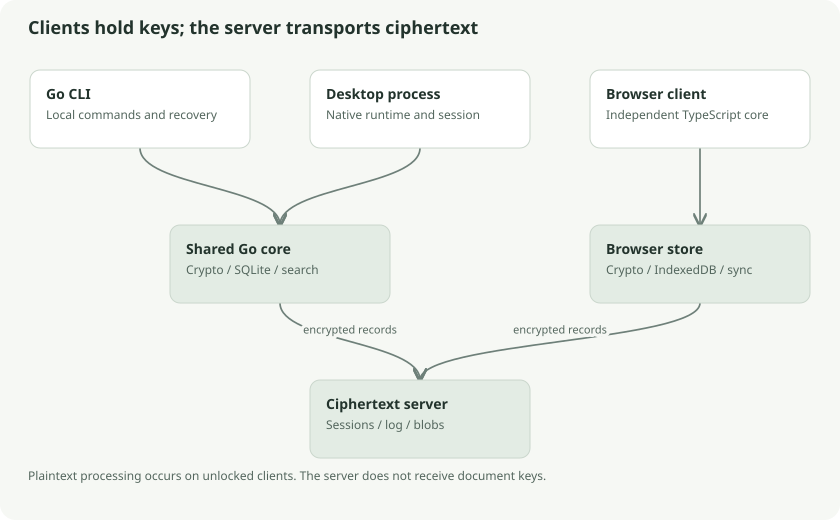

# The system map

Klefki is a local encrypted document store with a replication protocol. The clients understand documents and possess decryption keys. The server authenticates requests, stores opaque records, and coordinates delivery. This distinction explains most of the architecture.

This book describes application commit **bb78a53**, reviewed on **16 October 2026**, including the icon and sync-repair changes. Trash, permanent deletion and device-pending reporting are integrated into this source. These are source descriptions, not claims of hosted deployment or physical-device acceptance. Older milestone documents sometimes describe earlier behavior; use the linked implementation records for validation evidence.

## A useful analogy

Imagine several branches of your private archive. Each branch can open documents, label them, and create new editions. A courier transports sealed parcels and maintains a delivery ledger. The courier knows parcel IDs, their sizes, and their relationships, but cannot read the documents or labels inside.

In this analogy, clients are archive branches, the server is the courier, ciphertext chunks are parcels, and revisions are editions. The analogy stops at trust: a dishonest courier can hide an entire parcel or replay an old ledger. Encryption detects many altered parcels, but does not prove that the courier showed you every parcel.

## Where the responsibilities live

| Location | Technical responsibility |
| --- | --- |
| `core/crypto` | Key derivation, account wrappers, authenticated records, strict metadata parsing, chunk streams |
| `core/local` | Account containers, private publication of files, operating-system store leases |
| `core/sync` | SQLite document store, revisions, edits, replication, relay state, deletion, backup checking |
| `core/syncwire` | Shared Go transport structs and protocol constants |
| `server` | HTTP authentication, scoped storage, revision log, cursors, relay cleanup, presence |
| `core/search` | Extraction orchestration, encrypted indexes, ranked search, analysis and organization |
| `core/semantic` | Model assets, tokenizer, ONNX inference, vectors and field extraction |
| `core/desktop` | Unlocked-session ownership, operations, cancellation, synchronization scheduling |
| `cli` | Explicit local/network commands and backup/export workflows |
| `desktop` | Native process entry point and operating-system integration |
| `web/src` | Independent TypeScript crypto, IndexedDB store, sync client, passkeys, browser inference |

The root Go module is `klefki`. `desktop/go.mod` defines a second module, `klefki/desktop`, with `replace klefki => ..`, so its native executable consumes the shared core from this repository. The browser implements compatible behavior in TypeScript; it does not call the Go crypto package.

## The document journey

Our recurring example is **`electricity-bill.pdf`**, a 9 MiB PDF placed in a `Bills` folder. It is an invented teaching fixture, not a real user document.

1. An account creates a random master key and password/recovery wrappers.
2. Import creates a logical object ID, a revision ID, a content file ID, and a file key.
3. Metadata and three content chunks are encrypted locally.
4. A database transaction saves ciphertext and marks the revision pending.
5. Sync uploads missing chunks, then publishes the revision.
6. Another client verifies all records and commits the complete revision locally.
7. The receiving client acknowledges durable receipt.
8. Desktop/CLI extract text and store encrypted search sidecars.

Each step has different failure rules. Reading a chunk is not committing a document. Uploading chunks is not publishing a revision. Receiving a response is not acknowledging durable storage.

## How to read this book

Read chapters in order for a complete explanation. For a focused route, read keys → records → storage → sync for encryption and replication, or extraction → keyword search → semantic inference → organization for document understanding. The last chapter traces one complete example and provides a glossary.

The guide explains backend, storage, runtime, and security mechanics. Browser chapters concern persistence and executable-code trust. Visual components and styling are outside its scope.

## Follow the source

- [Root dependencies](../../../go.mod) and [desktop module](../../../desktop/go.mod)
- [Shared wire protocol](../../../core/syncwire/protocol.go)
- [Project milestone evidence](../../../MILESTONES.md)
- [Existing documentation index](../../README.md)

## Check your understanding

Why can two devices share encrypted documents without the server having the master key? Because they share the encrypted account state and unlock the same master key locally; the server only moves the encrypted records.
