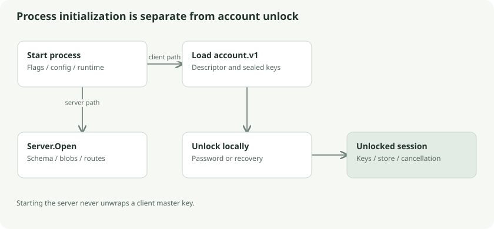

# Startup, account creation, and unlock

There are two different meanings of initialization: starting a process, and creating a cryptographic account. Starting a server does not create a client master key. Starting desktop does not automatically unlock its database. Keeping these separate helps you understand what can run while the vault is locked.

## Server startup

`cmd/klefki-server/main.go` parses the listener address, data directory, TLS options, optional web directory, and relay quota. It rejects incompatible listener modes before opening storage. The default listener is `127.0.0.1:8080`; normal operation requires a certificate and key. `-dev-http` permits HTTP only on a literal loopback address. `-proxy-http` supports an HTTPS reverse proxy and requires the forwarded HTTPS condition enforced by the server.

`server.Open` creates a private data directory and SQLite file, enables WAL and foreign keys, builds base tables, and runs migrations for sync, relay, deletion, and status. It opens a disk blob store and registers the HTTP routes. It does not decrypt a document during startup: there is no master key available to it.

The HTTP server bounds header size and timeouts. It listens until a listener error or interrupt/termination signal. On shutdown it allows a ten-second graceful shutdown window before closing the listener. If a built web directory was supplied, a handler serves that app and API from the same origin.

## CLI startup

`cli/main.go` dispatches commands to local encryption, sync, search, model, and backup handlers. It defaults the account path to `.klefki/account.v1`; the document database normally lives beside it as `local.db`. CLI commands load only what they need, rather than maintaining one permanently unlocked process.

Passwords are read from a hidden terminal prompt or an explicit secret file. They are not literal command-line secret values. A secret file strips one optional terminal line ending while preserving other bytes. This matters because `password`, ` password`, and `password ` derive different keys.

## Creating an account

`crypto.NewAccount` generates the account ID, a random master key, a random recovery key, and a salted Argon2id descriptor. It derives the password keys, encrypts the master key under the password KEK, and encrypts that same master key under the recovery key. The account file contains these public descriptors and encrypted wrappers.

The CLI writes the recovery code to an explicit private destination. Desktop's native wrapper selects a directory and confirms the recovery path. The recovery code is a second key to the archive, so the useful safety property is separate storage, not merely having another file beside the vault.

## Desktop session startup

The Wails executable owns a `core/desktop.Service`. The service loads configuration and starts maintenance/scheduling logic while keeping the account locked. On password unlock it loads `account.v1`, unwraps the master key, derives the sync credential, and starts an unlocked session. Recovery unlock recovers the master key without deriving a password-based network credential.

The current password path calls `Account.Unlock` and then derives password keys again to obtain the auth credential. That is an implementation detail with a performance consequence: the expensive KDF can run twice in that path. This description follows current source rather than assuming a single combined derivation.

An unlocked session owns the store, keys, cancelable context, network state, and optional model. Generation numbers distinguish sessions, so late work from an older session cannot be treated as current work after a lock/unlock cycle.

## Why opening and unlocking differ

Think of opening a storage room versus obtaining its keys. SQLite can open tables containing ciphertext without revealing filenames. Unlock produces the master key in memory; only then can metadata be authenticated and decoded. Encryption protects private payloads inside the database, rather than encrypting the whole SQLite file.

## Follow the source

- [Server entry point](../../../cmd/klefki-server/main.go): `run`
- [Server setup](../../../server/server.go): `Open`
- [CLI entry point](../../../cli/main.go): `run`, `initKlefki`, `password`
- [Desktop service](../../../core/desktop/service.go): `New`, `Create`, `Unlock`
- [Account generation](../../../core/crypto/crypto.go): `NewAccount`, `Account.Unlock`

## Go deeper

[Go contexts](https://pkg.go.dev/context) explain cancellation shared across operations. [Wails architecture](https://wails.io/docs/howdoesitwork/) explains why Go methods and native integrations can coexist with a browser runtime inside one executable.
