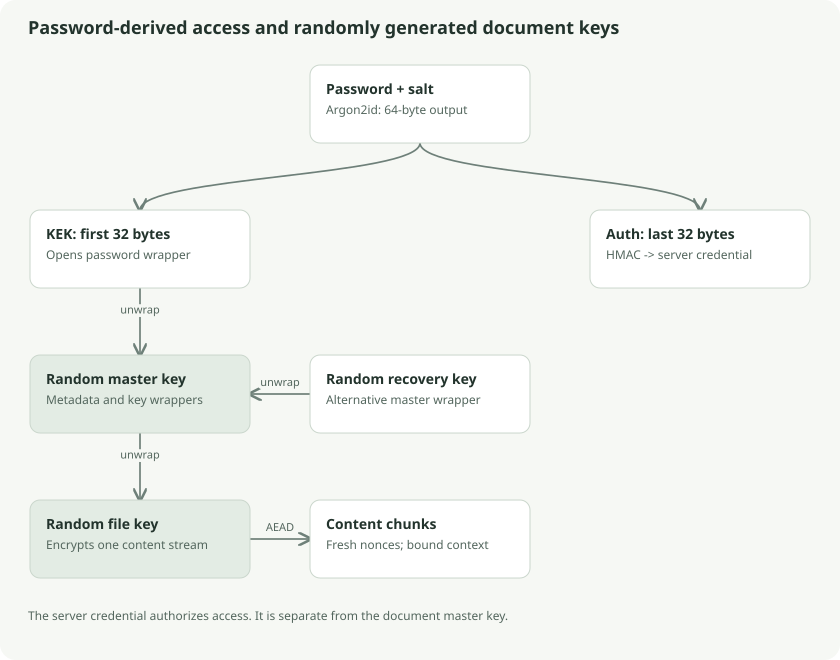

# Passwords, authentication, and the key hierarchy

Klefki separates three jobs: proving access to the server, unlocking the document collection, and decrypting one content revision. Separate keys make these jobs explicit and reduce the consequences of confusing them.



## The keyring analogy

The master key is the archive's keyring. Each document content revision has its own small key. The password opens a sealed box containing the keyring. The recovery code opens a second sealed box containing the same keyring. The server login credential is a courier access badge: it authorizes fetching parcels but does not open them.

The analogy is precise in one useful way: changing the outer box's lock need not change every document lock. It is incomplete in another: once someone copies a keyring, changing your password cannot make that copy disappear.

## Derivation, byte by byte

The 27-byte KDF descriptor contains version 1, algorithm identifier 1, memory **65,536 KiB**, iterations **3**, parallelism **1**, and a random **16-byte salt**. The implementation accepts this exact profile and rejects others before expensive work. This prevents an untrusted descriptor from silently selecting a weaker profile or requesting unbounded resources.

```text
K = Argon2id(UTF8(password), salt,
             memory=65536 KiB, iterations=3, parallelism=1,
             output=64 bytes)
KEK      = K[0:32]
auth_key = K[32:64]

credential = HMAC-SHA256(auth_key,
                        "vault/auth/v1\0" || account_id)
verifier   = SHA256("vault/auth-verifier/v1\0" || credential)
```

Argon2id makes each password guess consume memory and computation. A salt makes equal passwords in different accounts yield different keys. Neither guarantees a weak password is safe against offline guessing.

Go's KDF memory parameter uses KiB. Libsodium's TypeScript call uses bytes, so the matching number is **67,108,864**. Matching the units is required for the two implementations to derive identical keys.

Passwords are UTF-8 without normalization, trimming, or case conversion. The byte limit is 1,024. Invalid Unicode is rejected. These rules are compatibility requirements: changing string processing on one client could make an existing account impossible to unlock there.

## Keys created randomly

The master, recovery, and file keys are independently random 32-byte values. They are not document hashes and are not extracted from filenames. New file content gets a fresh file ID and key. A metadata-only edit can reuse the existing content key because the content is unchanged.

The KEK encrypts the master key in the password wrapper. The recovery key encrypts it in the recovery wrapper. The master key encrypts metadata and wraps file keys. File keys encrypt chunks. IDs and nonces are public context, not substitutes for secret keys.

## Authentication is separate from encryption

The server receives the derived credential over TLS and retains its domain-separated verifier. A leaked credential can authorize server access but does not directly recover the KEK or master key. The server can still capture a submitted credential, and the protocol is replayable bearer authentication rather than a password-authenticated key exchange.

Recovery uses the random key encoded as `vlt1-` plus 52 uppercase Base32 characters, for 57 characters total. This code does not go through Argon2id. Strict canonical decoding rejects altered case, padding, whitespace, and nonzero pad bits. A syntactically valid typo fails when the master wrapper is authenticated.

## Password rotation: design versus a command

The hierarchy permits generating a new salt and KEK, rewrapping the existing master key, and replacing the server credential. It does not require re-encrypting every document. That is a property of the hierarchy; it should not be mistaken for a shipped complete password-rotation workflow. The inspected CLI command dispatcher does not expose such a command.

## Follow the source

- [Go key primitives and accounts](../../../core/crypto/crypto.go): `Derive`, `Credential`, `Verifier`, `RecoveryCode`
- [TypeScript equivalents](../../../web/src/crypto.ts): `derive`, `credential`, `unlock`, `createAccount`
- [Approved format](../../crypto-spec.md)

## Go deeper

[RFC 9106](https://www.rfc-editor.org/rfc/rfc9106) specifies Argon2. [Libsodium password hashing](https://doc.libsodium.org/password_hashing) explains its API. Read these when the distinction between a KDF, ordinary hash, random key, and authentication credential feels unclear.
