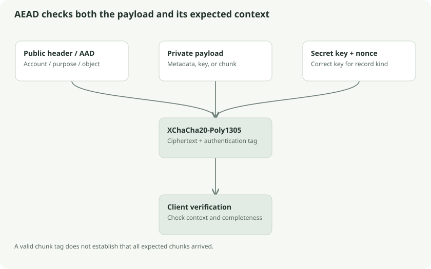

# Authenticated records and chunked files

Encryption must establish both secrecy and context. A decrypted block is useful only if it belongs to the expected account, object, purpose, and file position. Klefki packages those expectations in authenticated envelopes.



## Sealed parcels with authenticated labels

Imagine a sealed parcel whose label says account A, file F, chunk 2, final=false. The label can be visible, but opening the parcel verifies that its label has not changed. This is **additional authenticated data**, or AAD: information checked by authentication without being hidden by encryption.

Klefki uses XChaCha20-Poly1305, with a 32-byte key, 24-byte nonce, and 16-byte authentication tag. A fresh random nonce is used for each new encryption. Retrying a transfer sends the already-produced ciphertext; it does not create a new encryption merely because the network failed.

## Common record kinds

| Kind | Payload | Key | Bound object |
| --- | --- | --- | --- |
| 1 | Master key | Password KEK | Reserved zero ID |
| 2 | Master key | Recovery key | Reserved zero ID |
| 3 | File key | Master key | File ID |
| 4 | Metadata JSON | Master key | Logical object ID |
| 5 | Content chunk | Revision file key | File ID plus index/final state |

Kinds 1–4 have a 58-byte header: version, kind, 16-byte account ID, 16-byte object ID, and 24-byte nonce. AAD is the literal domain `vault/record/v1\0`, the complete header, and any kind-specific extra bytes. The password wrapper additionally authenticates the exact KDF descriptor. Kinds 1–3 carry 32-byte payloads and therefore occupy 106 bytes each.

The caller supplies expected account/object/kind. Trusting only a record's own header would allow a perfectly authentic record from the wrong context to be accepted.

## Chunk layout

| Offset | Bytes | Meaning |
| --- | --- | --- |
| 0 | 1 | Version |
| 1 | 1 | Kind 5 |
| 2 | 16 | Account ID |
| 18 | 16 | File ID |
| 34 | 8 | Zero-based chunk index |
| 42 | 1 | Final flag, exactly 0 or 1 |
| 43 | 4 | Plaintext length |
| 47 | 24 | Nonce |
| 71 | Variable | Ciphertext followed by 16-byte tag |

All integer fields are big-endian. A chunk occupies `87 + plaintext_length` bytes. Maximum plaintext per chunk is **4,194,304 bytes**, exactly 4 MiB.

## Worked example: a 9 MiB bill

```text
Authenticated metadata: size=9,437,184, chunk_count=3
chunk 0: 4,194,304 plaintext bytes, final=0
chunk 1: 4,194,304 plaintext bytes, final=0
chunk 2: 1,048,576 plaintext bytes, final=1
Total chunk-envelope overhead: 3 × 87 = 261 bytes
```

An 8 MiB file has two full chunks, with the second marked final; it has no extra empty chunk. A zero-byte file still has one final empty chunk. These cases prevent ambiguous framing.

## Complete-file authentication

The reader checks consecutive indices, expected account and file ID, permitted lengths, exactly the expected final position, total size/count, and no extra trailing records. Altering a final flag fails AAD authentication. Removing a final chunk can leave earlier tags valid, so complete-file validation remains necessary even after individual chunks authenticate.

Changed content gets a fresh file key. Mixing chunks from two content revisions therefore fails authentication under the selected revision key. Replaying an entire old, valid metadata/key/chunk set is different: the cryptography alone does not prove freshness.

## Metadata and containers

Metadata is UTF-8 JSON encrypted as exact bytes. Parsers reject duplicate fields, malformed Unicode, invalid IDs, and inconsistent size/count fields. Metadata also includes optional trash timestamps and previous-parent information. Those additions must not be confused with the original minimal metadata schema in older docs.

The account container `VLTA` version 1 is exactly 260 bytes. The standalone encrypted-file container `VLTF` contains IDs, a wrapped file key, a bounded metadata record, and chunk records. The sync database uses the same cryptographic records without requiring every document to be stored as a `VLTF` file.

## Follow the source and go deeper

- [Go records](../../../core/crypto/crypto.go): `Seal`, `Open`
- [Streams](../../../core/crypto/stream.go): `EncryptStream`, `DecryptStream`
- [Strict metadata](../../../core/crypto/metadata.go)
- [Local containers](../../../core/local/files.go) and [CLI file container](../../../cli/container.go)
- [Libsodium XChaCha20-Poly1305 documentation](https://doc.libsodium.org/secret-key_cryptography/aead/chacha20-poly1305/xchacha20-poly1305_construction)
