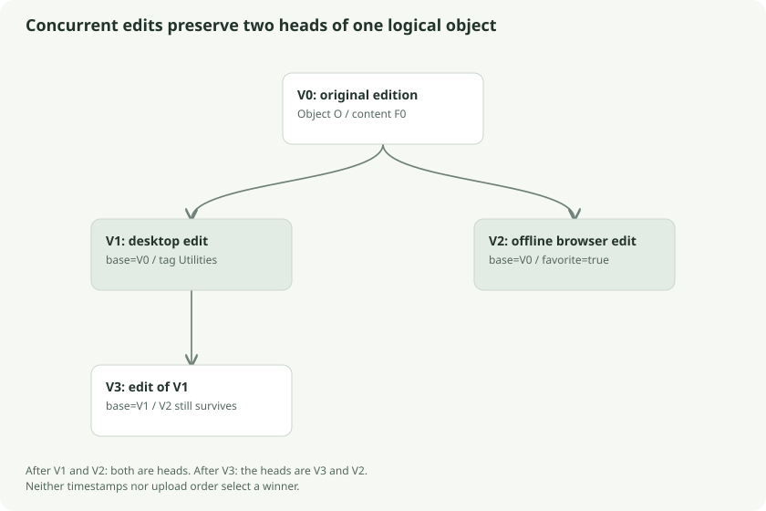

# Local storage, transactions, and revision graphs

The database holds encrypted records and the bookkeeping needed to replicate them. It is useful to separate a document's stable identity from an edition's identity and from a particular encrypted content stream.

## Four identities

| Identifier | Lifetime | Example role |
| --- | --- | --- |
| Account ID | Account lifetime | Which archive owns the records |
| Object ID | Logical document/folder lifetime | The bill despite later renames |
| Revision ID | One edit | A specific version of that bill's metadata/content |
| File ID | One content encryption | Which chunks and wrapped key belong together |

A rename creates a revision but can retain the file ID. Replacing document bytes creates a revision and fresh file ID/key. A folder has metadata and revisions but no document chunks.



## The ledger analogy

Instead of erasing an entry and writing over it, keep an append-only ledger of editions. Every edit says which edition it started from. That produces a graph of parent/child relationships. In normal history the graph is a line. Two offline edits produce a fork.

A **head** is a revision with no child. The head query finds revisions for which no other revision names them as its base. If an object has multiple heads, each is exposed as a conflict copy. The implementation does not select a winner by timestamp or arrival order.

For example, revision R0 is the original bill. Desktop creates R1 adding the tag `Utilities`. A disconnected browser creates R2 marking the same R0 as favorite. Both R1 and R2 remain heads after sync. Editing R1 later does not silently erase R2. There is no automatic field-wise merge merely because these particular edits could appear compatible.

## SQLite representation

The main tables are:

```sql
local_state(singleton, version, account, remote, cursor)
revisions(ordinal, id, object, base, metadata, file_key, pending)
chunks(file, idx, data)
```

Additional tables track stable relay identity, provenance, deletion state, and the versioned local pending-work report. `ordinal` orders local insertions; server sequence is a different ordering. `metadata`, `file_key`, and chunk data contain encrypted records. IDs, bases, queue flags, remote origin, and cursors are readable database structure.

Opening a store checks its account binding. Binding it to a server permits the initial origin or the existing origin; an accidental attempt to sync the same database to a different server fails. Use a separate store for another account/device. `OpenExisting` refuses a missing or uninitialized database, so backup tooling cannot mistake a new empty database for a successful recovery of the old one.

## Atomic offline edits

`PutContext` encrypts content into chunks and inserts chunks, metadata/key pair, revision, and pending flag inside one transaction. A short source stream, extra bytes, cancellation, or transaction failure causes rollback. You do not get a visible half-document with no pending queue entry.

This is like completing a bank transfer in one transaction: the document and the intention to replicate it belong together. A later network failure leaves the durable local edit pending. Network availability is not a prerequisite for editing.

## WAL and store ownership

The store enables SQLite WAL, foreign keys, a busy timeout, and current-source secure deletion. It uses one database connection and synchronization around operations. The operating-system lease protects the local store from competing processes; opening its canonical path takes a lock file lease. This is especially relevant when CLI and desktop might otherwise open the same database simultaneously.

WAL records database changes before incorporating them into the main database file. Copying only `local.db` while it is live can miss committed data still in `local.db-wal`. The snapshot chapter explains the correct backup path.

Encryption is at the record layer. There is no SQLCipher page encryption here. Secure-delete and compaction settings do not establish forensic erasure on SSDs, filesystem snapshots, hosting backups, or prior exported copies.

## Follow the source

- [Store implementation](../../../core/sync/store.go): `openStore`, `PutContext`, `Heads`, `applyTracked`
- [Metadata edits](../../../core/sync/edit.go): `Edit`
- [Unix leases](../../../core/local/lease_unix.go) and [Windows leases](../../../core/local/lease_windows.go)

## Go deeper

[SQLite WAL](https://www.sqlite.org/wal.html) explains the extra journal files. [SQLite atomic commit](https://www.sqlite.org/atomiccommit.html) explains why transactional publication is different from a collection of unrelated writes.
