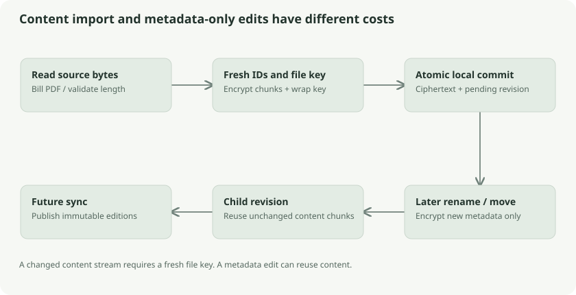

# Import, edits, folders, trash, and deletion

All normal document changes become encrypted revisions. Understanding which changes replace bytes and which replace only metadata explains both performance and conflict behavior.

## Importing the bill

Desktop's `Service.Import` schedules a cancelable file operation. It reads a selected source, validates metadata and parent relationships, and passes content to `Store.PutContext`. The store generates fresh content identifiers and a random file key, wraps that key, encrypts metadata, streams encrypted chunks into SQLite, and commits the pending revision.

The import path does not need a plaintext staging copy of the entire document in the local sync store. Browser import behaves differently: its store API receives a `Uint8Array` and prepares chunks in memory before the IndexedDB commit. The common envelope format does not imply equal memory use on the two clients.

## Renaming is cheaper than replacing content

`Store.Edit` loads the selected base revision, authenticates its metadata/key association, verifies that the base has no existing child locally, updates permitted metadata fields, encrypts new metadata with a fresh nonce, and inserts a child revision. It reuses the previous wrapped file key and stored content chunks.

Thus renaming `electricity-bill.pdf` to `September-electricity.pdf` does not encrypt another 9 MiB. Replacing the PDF with edited bytes does: `PutContext` generates a fresh content key/ID and ciphertext stream. Both actions still produce a new revision, so both can conflict with another offline edit.

## Folder trees are metadata references

A folder is a metadata object with type `folder`. A child's `parent` is a folder's object ID. Folders are not filesystem directories on the server; folder names and parent relationships within metadata are encrypted. The outer revision graph is visible separately.

Desktop validates parent selections and rejects cycles or unsuitable parents. A folder rename is another metadata revision. Moving a document changes its parent reference. The relevant model is a graph of logical objects, not a server filesystem path derived from a document name.

## Trash is a reversible change

The special trash folder is identified by the reserved tag `klefki:system:trash`. Moving a document or folder there is a metadata operation. Descendants inherit the ancestor's trash position. Their chunks remain available until permanent deletion, so restoration does not need to retrieve a lost plaintext file.

The metadata records `trashed_at` and `trash_previous_parent`. Previous-parent information makes restoration more meaningful than moving everything to the root. The source's retention constant is **30 days**. Dates use milliseconds in the encrypted metadata, matching browser date conventions.

## Permanent deletion is a separate protocol

Deletion is present in the base source. This section explains its implementation; [the trash guide](../../trash.md) records behavior and acceptance boundaries. Statements that deletion is unimplemented belong to the original M3 baseline.

Deleting a revision alone would allow an old offline copy to reintroduce the object. The new code instead records a permanent **object fence**. Imagine crossing an archive item off a registry that every branch must consult before accepting old deliveries.

`PreviewDeletion` gathers the selected trashed objects and descendants and includes their current heads. `DeleteTrash` recomputes those targets before erasing them. If the heads changed after the preview, deletion fails as a conflict instead of applying a stale decision. It also blocks permanent deletion in a bound store whose server does not support deletion.

The deletion wire record contains an object ID, folder flag, file IDs, and optional expected heads. A separate deletion feed has its own epoch and cursor. Sync processes fences before ordinary revisions and again at completion, so an old revision for a fenced object can be skipped while advancing the ordinary cursor.

Local erasure removes revisions/chunks and prunes encrypted search/analysis records that refer to deleted objects. The source includes compaction. Automatic expiry avoids unresolved conflict subtrees. These mechanisms explain intended logical deletion; they do not erase other devices' offline copies, preexisting backups, or storage-provider snapshots.

## Follow the source

- [Operations](../../../core/desktop/operations.go): `Import`, `Export`
- [Library mutations](../../../core/desktop/library.go): `Edit`, `Folder`, `Trash`, `Restore`
- [Revision edits](../../../core/sync/edit.go)
- [Trash lifecycle](../../../core/sync/trash.go)
- [Local deletion fences](../../../core/sync/deletions.go), [server deletion](../../../server/deletions.go), and [browser deletion](../../../web/src/trash.ts)

## Check your understanding

Why does a rename retain chunks but a content replacement generate new ones? The filename is encrypted metadata. The bytes are a separately encrypted stream with its own identity and key.
