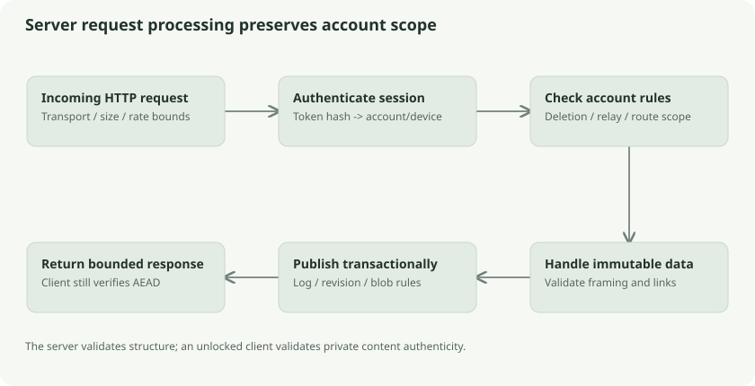

# The server: authentication, scope, and ciphertext publication

The server is an authenticated ciphertext service. It can validate public framing, account scope, revision links, and storage rules. It cannot authenticate private plaintext with AEAD because it does not have document keys; clients must perform that verification.

## Signup and login

Signup sends the account ID, KDF descriptor, two encrypted master wrappers, and derived credential. The server validates sizes and envelope headers and computes a credential verifier. It inserts the account and initial device session in one transaction. Duplicate registration returns a conflict rather than replacing the account.

Login sends the account ID and credential. The server computes the candidate verifier and compares it in constant time with the stored verifier. A successful login creates a random 32-byte session token and random device ID. The server retains a SHA-256 token hash and expiry, rather than the raw token. Default session lifetime is 30 days.

Authenticated requests use `Authorization: Bearer TOKEN`. Middleware hashes the token, finds a nonexpired session, and places account/device identity in the request context. Handler queries use that account identity. A client-supplied file ID must never establish account ownership by itself.

Think of an archive clerk checking an access badge, then looking only in the badge owner's shelves. The opaque parcel number identifies an item within those shelves; it does not authorize entering another person's shelves.

## Important routes

| Route family | Purpose |
| --- | --- |
| `/v1/signup`, `/v1/login` | Registration and session creation |
| `/v1/accounts/{account}` | Public encrypted account bootstrap records |
| `/v1/devices` | Session listing and revocation |
| `/v1/blobs/{file}/chunks/{index}` | Immutable chunk upload/download |
| `/v1/sync/revisions/{revision}` | Publish immutable encrypted revision |
| `/v1/sync/changes?after=N` | Read ordered account changes |
| `/v1/sync/cursor` | Record durable delivery acknowledgement |
| `/v1/sync/relay/*` | Stable relay devices, preparation, missing history |
| `/v1/sync/status`, `/v1/sync/presence`, `/v1/sync/provenance` | Progress/presence and opaque attribution |
| `/v1/sync/device-state` | Advisory versioned report of a device's pending local work |
| `/v1/sync/deletions` | Permanent-deletion feed and fences |

Legacy `/v1/metadata` endpoints remain alongside the revision protocol. They should not be treated as the authoritative view of every later edit.

## SQLite plus disk blobs

The server database contains accounts, session hashes, encrypted metadata, revision/change records, delivery cursors, and extension state. Chunk payloads live in an account-scoped disk blob store. This separates large binary transfers from relational bookkeeping.

Chunk publication is immutable. Repeating an upload with identical ciphertext is safe. An attempt to reuse an existing location with different bytes returns a conflict. A server restart or a lost HTTP response therefore does not require inventing a new file revision to retry a chunk.

Revision publication verifies structural expectations and base-object relationships, then appends one sequence to the change log transactionally. It is also idempotent for an identical revision ID and body. A reused revision ID with changed bytes or links fails. Chunks may exist before a revision is published; that is intentional staging, not yet a complete visible edit.

## Limits and transport

Request decoding is bounded and rejects malformed input. The rate limiter is a token bucket: by default it allows a burst of 120 and replenishes 120 tokens per minute. Login additionally checks an account bucket; normal request handling applies its other limiter scope. These are request budgets, not a claim of 120 successful logins per minute for every situation.

Normal clients use TLS and reject redirects. Development HTTP is loopback-only. Reverse-proxy mode requires correct trusted deployment configuration; forwarded headers are not magically authenticated if the backend is exposed directly to attackers.

Request logs deliberately avoid secret bodies and document contents. The server still sees operational data: IDs, sizes, timing, account relationships, delivery activity, and peer addresses. Client-side encryption protects private payloads, not all traffic metadata.

## Follow the source

- [Server routes/authentication](../../../server/server.go): `Open`, `signup`, `login`, `auth`, `allowed`
- [Disk blobs](../../../server/blobs.go)
- [Revision publication](../../../server/sync.go): `appendChange`, `putRevision`
- [API reference](../../server-api.md)

## Check your understanding

Can the server approve an AEAD tag? It checks framing and immutable storage rules, but tag verification belongs to a client with the proper key. TLS authentication and content authentication solve different problems.
