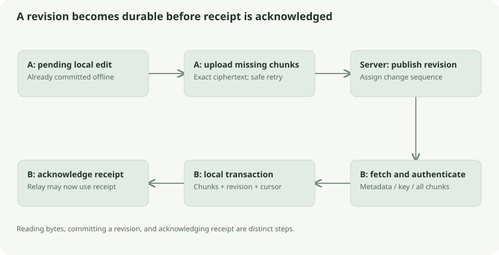

# Offline synchronization, cursors, and failure recovery

Sync is a sequence of durable transitions. Its main safety rule is that a receiving client acknowledges progress only after saving a complete authenticated revision. A cursor is a bookmark in a delivery ledger, not a cryptographic proof of the ledger's honesty.



## Push in dependency order

Pending revisions are selected in local insertion order. A locally created base therefore precedes its child. Before upload, the Go client checks the local revision's content integrity. It inventories existing remote chunks and uploads missing ones, using the stored ciphertext exactly.

After all chunks have been accepted, the client sends `PUT /v1/sync/revisions/{id}`. Only a successful immutable publication clears the local pending flag. Suppose all three bill chunks arrive but the last response disappears: retry inventories the server, finds those chunks, and proceeds to publication. Suppose the publication succeeded but its response disappeared: repeating the same revision returns the original sequence.

## Pull from the local bookmark

The client requests changes after its **local durable cursor**, not the server's recorded acknowledgement for a session. A new local store starts at zero even if some old session acknowledgement is ahead. Acknowledgement records what a client reported; it does not populate an empty local database.

The change page contains at most **16 records**. Sequences increase but need not be consecutive, because the server log is shared across accounts. Account-scoped queries prevent another account's changes from being returned.

For each change, the client validates identifiers, authenticates encrypted metadata and file-key association, fetches the expected chunks, and checks their entire-file context. It commits the complete revision and updated local cursor together. Earlier good revisions can remain committed if a later revision fails, but the failed revision does not become visible or advance its bookmark.

## Receipt before acknowledgement

Imagine signing for a shipment only after you have inspected every parcel and put it safely into your warehouse. Sending the receipt while the goods are still on the loading dock would let a relay delete the only available copy too early.

```text
remote download
    -> authenticate every required record
    -> commit chunks + revision + cursor locally
    -> PUT server acknowledgement
```

An acknowledgement failure is recoverable. The local cursor survives and can be acknowledged again. A download failure retains the previous local cursor. Uploaded chunks resume individually; an incomplete downloaded revision is retried as a revision rather than being exposed as a partial document.

## Retry rules

Network failures, HTTP 408, 429, and most server 5xx responses can be retried. **507 (insufficient storage)** is an explicit exception: the client must resolve the relay/storage condition instead of blindly repeating it. Default Go behavior uses up to four attempts, exponential delays beginning at 250 ms, and a 30-second backoff cap. An integer `Retry-After` up to 120 seconds can override that cap. All waits observe cancellation. Configured attempts are capped at ten.

Authentication failures, conflicting immutable records, malformed data, and failed cryptographic checks do not become successful by repeating them blindly. The stored pending queue remains available for a future sync after the real issue is resolved.

Sync additionally exchanges deletion fences before normal transfer and again at completion. A fenced object is not resurrected by replaying its older revisions. This adds requests beyond the published pre-deletion benchmark flow.

## Two kinds of concurrency

Only one sync pass runs against a Go store at a time through `syncMu`. Revisions publish sequentially because parents and cursors need ordered reasoning. Inside a revision, up to four chunk transfers can run concurrently. Results are consumed in index order; network completion order does not determine authenticated file order.

Content integrity and honest-server conflict handling are strong local rules. Server sequences and parent links themselves do not establish authenticated global history. A malicious server's omitted revisions or complete rollback remain outside the protocol's freshness guarantees.

## Presence, provenance, and durable receipt differ

The status extension separates a device's live activity from its durable cursor. Presence reports client kind, phase, opaque revision ID, transfer direction, and byte progress under the authenticated account and stable device identity. A client may be uploading now while its durable receipt cursor still describes only earlier committed revisions.

The server stores client kind and last-contact time in SQLite, but keeps live phase/progress in memory. Status uses a live-presence window of 45 seconds; after restart, the persisted last-contact record survives while live phase becomes unknown. This prevents a stored “downloading” value from pretending an interrupted process is still active.

Provenance distinguishes an edit's original device from the client that published it. They can differ when a retained local copy reseeds a relay. Attribution is opaque operational bookkeeping, not an authenticated authorship signature. Private device nicknames remain local. Progress objects inside clients can include decrypted filenames, but those names are not part of the server presence payload.

`NeedsSync` compares server/local state to decide whether work is due. A green-looking activity state would never substitute for the transaction-and-acknowledgement ordering above. The current deletion extension also adds its own sequence signal to status so a device can notice deletion work even when ordinary revision progress is unchanged.

## Pending work can outlive live presence

The integrated device-state extension adds an advisory report: a stable device ID, a monotonically ordered version, and a boolean indicating pending revisions or deletions. The server stores the report and its receipt time in SQLite. Unlike transient presence, a report can survive the source device closing and a server restart.

The local store snapshots pending work and the report version transactionally. Clients advertise/report this state through the existing monitoring flow when the server supports it. A late report cannot overwrite a newer version. Reports contain no document names or contents.

A device that last reported pending work can therefore remain labelled as having changes waiting even after another device has received all revisions currently on the server. This separates server delivery from unpublished local changes. The report is advisory: changes made entirely offline cannot be known remotely until that source reports them, and a saved report is not a backup or proof of complete synchronization. See [sync activity](../../sync-status.md) for freshness and interface wording.

## Staging a fresh desktop copy safely

The desktop `FreshDownload` operation downloads into a separate private directory beside the selected store. It keeps the encrypted account file and original database intact. It requires a server connection and an authenticated unlocked session, and refuses recovery-only access, pending local work, or an active sync. It authenticates the original store first, so it is not a bypass for corrupt local ciphertext.

The operation logs in to the existing remote account; it never signs up again or switches the server's storage mode. Its staging store has its own durable cursor and stable device identity. A failed or interrupted download retains that staging path so another attempt resumes the same store and device instead of enrolling another relay device each time. In temporary relay mode, linked devices may need to provide retained history before this new copy can finish.

After sync, the client authenticates the staged store and checks coverage against every revision known to the original store. A missing revision is accepted only if its object has a deletion fence in the new store. It does not select an incomplete replacement. This establishes coverage of known local history, not proof that an untrusted server disclosed every unknown revision.

Only after those checks pass does the service persist the new selected store path and remember the original as `previousStorePath`. It then detaches the old session, cancels work, and locks; the next unlock opens the verified copy with the existing account. Sync-pause preference is preserved. A download, validation, cancellation, or configuration-save failure leaves the original selected. The retained original is not automatically deleted.

This recovery flow provides a checked fresh-copy option. Its implementation alone does not establish the cause of a particular Linux stale-sync report or demonstrate that report was reproduced. See [sync activity](../../sync-status.md) for user-facing recovery guidance and validation limits.

## Follow the source and go deeper

- [Client state machine](../../../core/sync/client.go): `Client.Sync`, `push`, `request`
- [Authenticated local import](../../../core/sync/store.go): `applyTracked`
- [Browser equivalent](../../../web/src/sync.ts): `sync`, `push`
- [Client status and provenance](../../../core/sync/status.go), [server presence and status](../../../server/status.go)
- [Desktop staged download](../../../core/desktop/fresh_download.go), [integrity checking](../../../core/sync/backup.go)
- [Baseline protocol](../../sync-protocol.md)
- [HTTP Retry-After](https://developer.mozilla.org/en-US/docs/Web/HTTP/Reference/Headers/Retry-After)
