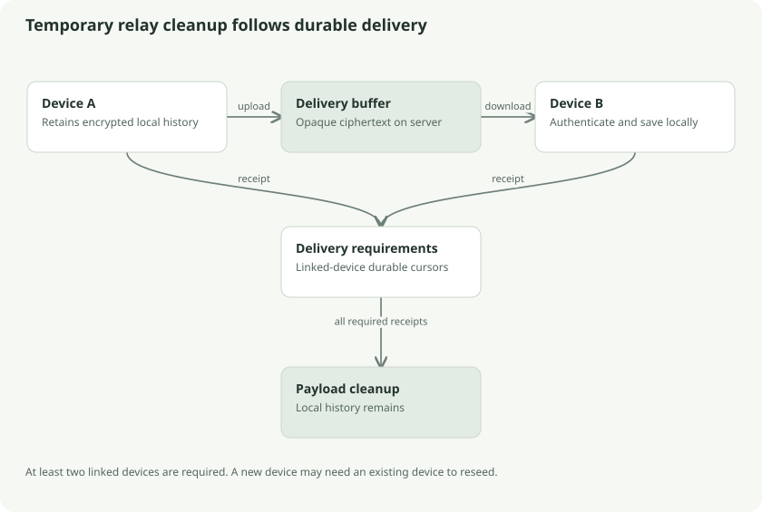

# Temporary relay, batching, and transfer performance

Persistent mode keeps server payloads. Temporary relay mode removes delivered ciphertext once all linked devices have acknowledged saving it, with at least two devices required. Local history and backups become especially important because the relay is a delivery buffer rather than a permanent archive.



## Session identity versus store identity

Logging in creates a session device ID. Temporary relay needs an identity that survives login/logout and process restarts, so each local store also owns a stable random relay device ID. These are related but different identifiers.

The relay records device membership, account mode, epoch, delivery cursors, and revision digests. A server epoch identifies a particular relay state. If an ephemeral host loses state, a new epoch lets clients reset server progress and offer retained local history again. Existing clients provide ciphertext; the server does not reconstruct missing documents from a password or recovery code.

## The parcel-locker analogy

Two devices use a shared locker. Device A puts in encrypted parcels; device B collects and durably stores them. Only after the delivery requirements are satisfied can the locker empty. A newly linked device after cleanup needs an existing client to refill the locker from its own archive.

An acknowledgement is a trusted client's assertion, not mathematical proof of possession. An unavailable linked device can prevent cleanup. Forgetting a device changes those delivery requirements, so it has stronger consequences than changing a private device nickname.

## Why small files can feel slow

Transfer time is roughly:

```text
sequential_request_count × round_trip_latency
+ payload_transfer_time
+ local encryption/storage/verification time
```

This is an intuition, not a precise network simulator. Ten sequential requests at about 300 ms each can consume roughly three seconds before payload work is significant. A fast disk or stronger CPU cannot remove remote round trips.

The published October optimization combined relay preparation with a batch of history checks. `POST /v1/sync/relay/prepare` carries device state and up to **256 revision IDs**. Additional batches use `/need-batch`. Legacy `/device` and `/need` remain with 404/405 fallback for compatible older servers.

The measured pre-deletion 84-revision no-edit path went from ten production requests to three: preparation, changes, and durable acknowledgement. Current deletion and device-state exchanges add protocol work; that historical request count does not describe every current sync pass.

## Four chunks at once

Go and browser clients use bounded windows of four transfers. A 9 MiB file has only three chunks, so one window can handle its content transfers. A 64 MiB file has sixteen chunks, handled in four windows. Four 4 MiB results imply about 16 MiB of payload buffering per full window, plus envelopes and other memory; this is an estimate of window payloads, not the application's total memory ceiling.

A failed transfer cancels siblings and waits for them before returning. Results are then processed in index order. Shared `Retry-After` cooldowns keep parallel workers from independently hammering a throttled server. Revision publication stays sequential.

## Account-scoped locking

The server uses reference-counted locks keyed by account. Quota checking, publication, and cleanup for one account are serialized. Bounded upload reads and buffered download writes occur outside that critical section. Otherwise a slow network read while holding a global lock would block unrelated accounts and neutralize client concurrency.

This does not imply unlimited server parallelism. SQLite still uses one connection in this implementation, disk I/O still costs time, and account operations still coordinate under their lock.

## What measurements establish

The repository's October report records no-edit Go time moving from **3.618s to 1.034s** and 64 MiB browser upload from **40.585s to 18.801s** in hosted sweeps. These are historical session measurements of the combined update, with stated automation/history limits. They have not been rerun for this guide's current source snapshot and are not a long-term latency guarantee.

## Follow the source

- [Client relay preparation](../../../core/sync/relay.go): `prepareRelay`, `saveRelay`
- [Bounded chunk windows](../../../core/sync/chunks.go): `chunkWindows`
- [Server relay](../../../server/relay.go): `cleanupRelay`, `relayPrepare`
- [Lock/buffering boundaries](../../../server/relay_lock.go)
- [Exact benchmark report](../../benchmarks/2026-10-13-relay-optimization/README.md)
