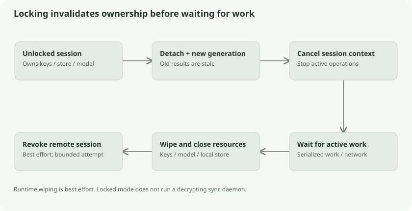

# Unlocked sessions, cancellation, and convenience access

Locking is a resource transition. It must stop operations, detach private state, close owned resources, and clear key copies. Merely drawing a lock screen would not establish that boundary.

## Ownership and generation numbers

`core/desktop.Service` owns an optional unlocked session. That session holds the master key, sync credential, local store, operation context, remote session, and optional model. The service's generation increments when the session is invalidated. Results/events carry generation information so late completions do not belong to a newly unlocked session.

Think of lending a contractor a keycard valid for one shift. Canceling the shift invalidates outstanding work. A later shift gets a new identity even if it uses the same room. Checking only “the room is currently open” would accidentally accept yesterday's job result.

## Lock order

The current `Lock` implementation detaches the session, increments generation, cancels its context, resets scheduling state, and emits the locked event before waiting for active work. It then waits for serialized work and network completion, closes the optional model, wipes master/credential arrays, and closes the store. It attempts server session revocation asynchronously with a five-second timeout.

Cancellation before waiting avoids a deadlock-like lifecycle where lock waits indefinitely for work that has not been told to stop. A failed revocation does not restore local keys, but can leave the remote session valid until expiry or later revocation.

Go clearing and JavaScript memory wiping are best effort. The runtime, immutable strings, native libraries, swap, or earlier copies can retain sensitive data. The design minimizes lifetime; it does not claim guaranteed physical erasure of every copy.

## Scheduling while unlocked

The desktop watcher evaluates inactivity every second, requests periodic background sync at sixty-second intervals, and checks trash maintenance hourly in the current source. Network monitoring, local changes, and explicit sync requests also influence scheduling. These timers are not a daemon that can decrypt and sync a locked vault.

File operations use contexts and cancellation. The `work` lock serializes sensitive store/model operations, while network lifecycle tracking lets locking wait for them to finish safely. Large operations therefore have both a progress lifetime and a secret-owner lifetime.

## Linux fingerprint convenience

Klefki delegates biometric verification to `fprintd` over the system D-Bus. It does not derive a cryptographic key from the fingerprint image or enroll templates. After password unlock and successful verification, it saves a record containing the master key and sync credential in the OS secret service/keyring, bound to the selected account.

On later unlock, a successful system verification permits loading those saved keys. Password and recovery remain other access routes. The security boundary is the OS keyring and session permissions: another app able to read an unlocked keyring may access stored unlock secrets. Fingerprint verification is an application convenience gate, not a claim of hardware-sealed document encryption.

## Browser passkey PRF

The browser route uses a different mechanism. WebAuthn PRF produces a repeatable secret for a credential and input after required user verification. Klefki derives a 32-byte wrapping key with HKDF-SHA256 and encrypts a 64-byte payload containing master key plus sync credential with XChaCha20-Poly1305.

The local wrapper binds version, origin, relying-party ID, account-file hash, credential ID, salt, and nonce-related record state. Loading checks origin/account binding; assertions check the challenge, credential ID, relying-party hash, presence, and verification flags. This is local convenience unlock, not a new server login protocol.

The wrapper lives in localStorage as ciphertext. Secure origin and compatible authenticator/browser PRF support are required; a domain or localhost is used rather than an IP origin. The provider may use fingerprint, face, or PIN and may sync passkeys. Removing local setup does not revoke a copied valid wrapper.

## Follow the source and go deeper

- [Session lifecycle](../../../core/desktop/service.go): `Lock`, `with`, `watch`
- [Fingerprint core](../../../core/desktop/fingerprint.go) and [Linux adapter](../../../desktop/fingerprint_linux.go)
- [Passkey wrapper](../../../web/src/passkey.ts): `wrappingKey`, `assertion`, `enable`, `unlock`
- [WebAuthn extensions including PRF](https://developer.mozilla.org/en-US/docs/Web/API/Web_Authentication_API/WebAuthn_extensions)
