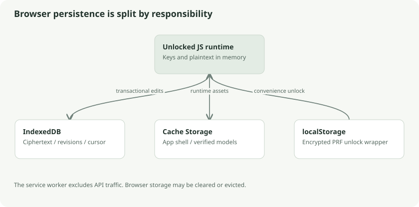

# Browser persistence and native runtime boundaries

The browser client is a second implementation of the encrypted store and protocol. Its important technical differences are storage APIs, transaction lifetimes, executable-code delivery, and memory behavior. This chapter concerns those mechanics, not the interface.

## IndexedDB as the local ciphertext database

`Store.open` uses an account-specific database name, `klefki-v1-` followed by the account ID. The database version is 2. Object stores hold state, revisions, chunks, and deletion fences. Account initialization checks that the stored account descriptor/wrappers match the chosen account.

Each revision contains encrypted metadata, optional wrapped file key, pending flag, insertion order, and optional origin information. Chunks are keyed using file ID and index. The state store holds account state, cursor, bound origin, stable relay identity, and the versioned pending-work report.

`Store.commit` writes revisions, chunks, state, and deletion checks in one read/write transaction. It validates base ownership, immutable retries, and current local edit assumptions. A received sequence is saved in the same commit as its accepted ciphertext.

## Async request success is not transaction success

IndexedDB has request events and transaction events. One successful `put` request does not mean the entire transaction committed. Klefki's transaction helper waits for `oncomplete` and treats abort/error as failure.

An analogy is a restaurant order: the kitchen accepting each item is different from the complete order being delivered. A later abort can invalidate earlier successful requests in the same transaction.

IndexedDB transactions also have lifetimes tied to queued database work. Arbitrary network waits inside them can let a transaction become inactive. The browser sync path gathers/authenticates received data before local publication. The Go path can hold a SQLite transaction across downloads; identical protocol guarantees do not require identical storage choreography.

## Why the browser can use more memory

The store's `put` receives complete bytes and builds encrypted chunks in memory. `export` fetches chunks and produces authenticated plaintext for the caller. The Go streaming path can process document content in bounded pieces. Both enforce the format's 4 MiB chunk rule, but that does not make the browser's whole-document workflow a streaming pipeline.

Stored ciphertext surviving browser restart does not imply storage is guaranteed permanent. Browser quota, site-data clearing, private browsing behavior, and eviction can remove the database. Sync copies and separately verified backups remain necessary.

## Service worker responsibilities

`web/scripts/sw.mjs` generates a content-hashed app-shell cache. The worker handles selected same-origin GET resources. It explicitly avoids `/v1/` API requests, search-bearing URLs, and unrelated origins. Model assets use a fingerprint-specific cache. Activation removes old app-shell caches and claims clients; explicit update activation can invoke `skipWaiting`.

This worker enables executable shell assets to be available offline. It does not store master keys, perform OCR, or act as a locked-vault sync daemon. The encrypted document database and the app-shell cache have separate purposes.

## Code delivery is a trust boundary

A browser origin supplies the JavaScript that receives passwords and handles unlocked keys. A compromised origin can serve malicious code on a later load/update, even if every document on the server is encrypted. HTTPS protects transport to that origin; it does not make the origin incapable of abusing its own application code.

The native desktop executable instead embeds built assets using Go `embed` and binds Go methods through Wails. Its filesystem access and secret-service integration live behind the native wrapper/core. Desktop still requires trusted builds and distribution. Rebuilding native code without rebuilding embedded assets can ship an older client runtime; `make linux-build` deliberately builds assets first.

## Follow the source and go deeper

- [IndexedDB implementation](../../../web/src/store.ts): `open`, `transaction`, `commit`
- [Worker generator](../../../web/scripts/sw.mjs)
- [Native executable](../../../desktop/main.go) and [build order](../../../Makefile)
- [MDN IndexedDB](https://developer.mozilla.org/en-US/docs/Web/API/IndexedDB_API)
- [MDN service workers](https://developer.mozilla.org/en-US/docs/Web/API/Service_Worker_API)
- [Go embed](https://pkg.go.dev/embed)
