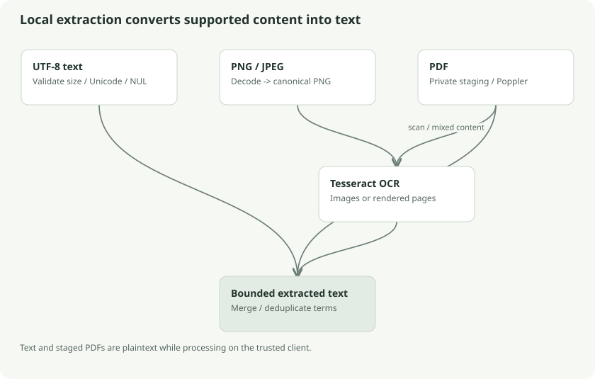

# Local text extraction and OCR

Search cannot match document content until content has been converted into text. Klefki performs that conversion on an unlocked trusted client, then encrypts the index produced from it. The server never needs a plaintext search copy.

## Three input paths

Supported UTF-8 text extensions include `.txt`, `.md`, `.csv`, `.json`, and `.log`. The extractor rejects invalid UTF-8, NUL bytes, or input above its text limit. Unsupported formats can still exist as encrypted documents; they receive metadata search coverage rather than full content extraction.

PNG/JPEG inputs are decoded and re-encoded as PNG before being passed to Tesseract on stdin. Tesseract can interpret some inputs as filename lists, so passing raw bytes from a mislabeled upload would create a dangerous ambiguity. Canonical re-encoding ensures the tool receives actual image data. Pixel dimensions are checked before full decoding.

PDFs use Poppler tools plus Tesseract. A PDF can contain selectable text, scanned images, or both. Choosing “has any text, therefore skip OCR” would miss content printed inside images on an otherwise textual page.

## PDF pipeline

1. Stage the PDF in a private temporary directory with private file permissions.
2. Use `pdfinfo` to read page count and enforce the page cap.
3. Use `pdfimages -list` to inspect page images and bounded dimensions.
4. Run `pdftotext` once for the document, then split extracted text by page.
5. OCR page images when applicable, or rasterize the displayed page for scans/masked composites.
6. Merge OCR terms with selectable text and return bounded output.
7. Remove temporary files and wipe available byte buffers.

When a page has no useful text or includes image masks/composites, it uses `pdftoppm` to render the page as displayed before OCR. That preserves rotation and visual compositing better than assuming an extracted image alone represents what the reader sees.

## Worked example: a mixed bill

Suppose the PDF has selectable text saying “Electricity statement” and a scanned image containing meter ID `MTR9021`. `pdftotext` finds the heading but not the meter ID. Image OCR contributes `MTR9021`, enabling a precise later keyword match. Merging avoids inflating frequency counts by indiscriminately duplicating words already present in selectable text.

The extractor caches OCR results for repeated PDF image object identities within a document. A repeated logo does not need to start Tesseract on every page. Limits still apply to cached text, pixels, and page content.

## Resource bounds

The current extractor permits at most **64 MiB** per supported document, **2 MiB** extracted text, and **100 PDF pages**. Image decoding caps one image at **16 million pixels**; PDF inspection applies additional per-page bounds. Each extraction uses a three-minute cancelable timeout. Tesseract gets `OMP_THREAD_LIMIT=1`, and child-process stderr is discarded to avoid leaking untrusted/private tool output into logs.

These are extraction limits, not the cryptographic format's maximum file size or every client upload limit. A document can be valid for encrypted storage and still be too large to OCR.

## Plaintext lifetime

The in-memory export and tool input are plaintext while processing. PDF staging is also plaintext. `Extractor.TempDir` can select a private RAM-backed location, but default OS temporary storage need not be RAM. Ordinary cleanup is not guaranteed erasure after a crash, filesystem snapshot, or storage-device remanence.

This is the photocopier-room analogy: the archive remains encrypted at rest, but an authorized clerk must temporarily read a page to transcribe its text. The local tools, native parsers, and temporary directory are part of the trusted processing boundary.

Web reads synced indexes; it does not run this OCR pipeline or build content indexes itself.

## Follow the source and go deeper

- [Extraction dispatch and subprocesses](../../../core/search/extract.go): `Text`, `command`
- [Mixed PDF extraction](../../../core/search/pdf.go): `pdf`, `pdfImages`, `mergeOCR`
- [Prerequisites and evidence](../../m7-status.md)
- [Official Tesseract documentation](https://tesseract-ocr.github.io/tessdoc/)
