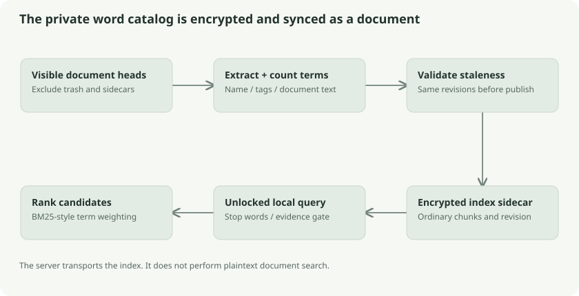

# Encrypted keyword indexes and ranked search

Klefki builds a term-frequency index locally, encrypts it as an ordinary internal document, and syncs it through the same revision protocol. Another client can search the index without repeating PDF extraction or OCR.



## The library-catalog analogy

An archive clerk reads documents and writes a catalog listing which words occur in each one and how often. The clerk locks the catalog before sending it to another archive. The courier can deliver it but cannot use it to search the collection. An unlocked client opens the catalog and ranks results locally.

This is not a server-searchable encryption scheme. A client decrypts the index while searching. Term frequencies can reveal private information, so the catalog itself must be encrypted.

## Building the index

`search.Build` snapshots current document heads, excluding internal sidecars and documents hidden under trash. For each supported document it exports authenticated content, extracts text, and counts terms from filename, tags, and extracted text. Unsupported formats still contribute name and tag terms.

The serialized index contains version, extraction language, and document entries identifying object/revision, term counts, and document length. The index payload is bounded to **32 MiB**. A sidecar tagged `klefki:system:search-index` and an extraction-format tag is saved with `Store.PutContext`, giving it encrypted metadata, its own file key/chunks, and a pending revision.

The builder compares the selected documents with current heads again before publication. If documents changed during extraction, it returns a stale error rather than claiming its old catalog matches the new collection. Keyword and semantic sidecars publish separately; cancellation between them does not imply one atomic paired-index update.

## Query terms and evidence

Query input is bounded to 4,096 bytes and 64 distinct tokenized terms. Query-only stop-word filtering removes common words without altering the stored index format. “Please show me the electricity bill” focuses on content-bearing terms rather than allowing common words to dominate.

The evidence gate normally needs one meaningful term for short queries. For longer queries it needs a stronger count, capped at three. A matching term containing a number can qualify directly, preserving useful exact references such as `MTR9021` inside a long question.

## BM25-style scoring

For each query term in each document, the implementation computes:

```text
idf = ln(1 + (N - df + 0.5) / (df + 0.5))
contribution = idf × (tf × 2.2)
               / (tf + 1.2 × (0.25 + 0.75 × length/average_length))
score = sum(contributions for matching query terms)
```

`N` is document count; `df` counts documents containing the term; `tf` counts occurrences in this document. Rare words get more weight. Repeated words help with diminishing returns. Length normalization reduces the tendency for a huge document to win merely because it contains more words.

For intuition, if only one of ten bills contains `MTR9021`, that identifier has stronger distinguishing power than `bill` appearing in all ten. Exact scores depend on document lengths and frequencies, so this example describes ranking direction rather than a fixed expected number.

This implementation scans stored document term maps and computes scores in memory. It does not run SQL full-text search, Elasticsearch, or an inverted-index service on the server. That simplicity has a scaling tradeoff: query work grows with indexed documents and query terms, and loading/decrypting the index costs memory/time.

## Staleness and fallback

Loaded index entries must correspond to visible revisions. A stale index is not silently treated as current content evidence. Desktop can rebuild missing/stale indexes and indexes imports. Browser uploads retain name/tag coverage until a desktop/CLI builds content indexes and syncs them.

Tied scores are ordered by revision ID for reproducibility. Search scores rank candidates; they are not probabilities that a document is correct.

## Follow the source

- [Index construction and BM25](../../../core/search/index.go): `build`, `load`, `Query`
- [Evidence gates](../../../core/search/relevance.go): `relevantQueryTerms`, `keywordEvidence`
- [Browser search parity](../../../web/src/search-ranking.ts) and [browser index consumer](../../../web/src/semantic.ts)
- [Search acceptance fixtures](../../../core/search/acceptance_test.go)

## Check your understanding

Why encrypt a word-count index if it does not contain complete original paragraphs? Words, identifiers, frequencies, and document associations can disclose private content even without the original layout.
