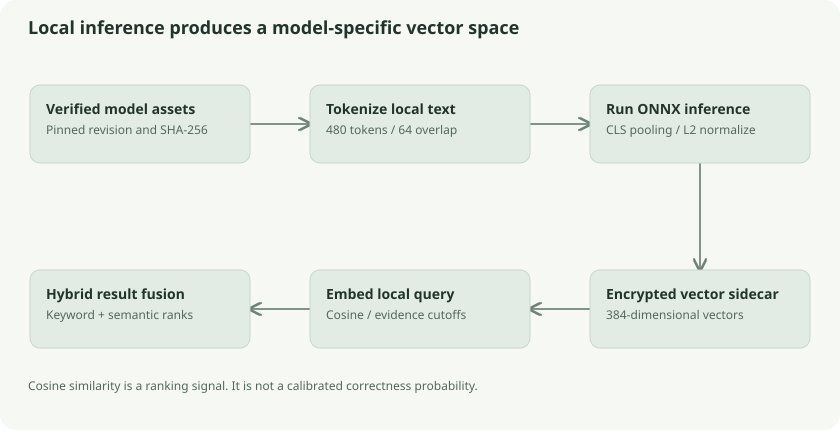

# Local embeddings, ONNX inference, and hybrid search

Keyword search asks whether words match. Semantic search compares learned vector representations so related wording can match. Klefki runs inference locally; it does not send documents or queries to a hosted AI provider.



## The coordinate-map analogy

Imagine placing documents on a map where nearby coordinates represent related meaning. “Monthly electricity charge” and “utility invoice” may land nearby despite different words. Real embeddings have **384 coordinates**, not two, and their geometry is learned rather than manually assigned.

The analogy helps explain similarity but cannot justify trust: nearby vectors do not prove the same identity, correct classification, or factual agreement. Embeddings can be misleading, particularly outside the model's language/domain.

## Assets and model identity

The manifest pins **BAAI/bge-small-en-v1.5** to an exact model revision, asset byte lengths, SHA-256 digests, tokenization/pooling settings, and runtime version. Model installation downloads public model assets or checks a local bundle; it does not upload vault data. `Verify` checks the expected files before native model use.

A fingerprint connects semantic indexes to their producing model/configuration. Comparing vectors from different models or tokenization settings as if they occupied the same space would produce meaningless scores even if both vectors had 384 elements.

Native inference is compiled with the `onnx` build tag. Without that tag, `model_disabled.go` explicitly returns unavailable. The inspected native support is Linux/Windows on amd64. It uses an ONNX Runtime shared library and a tokenizer; inference calls are serialized with a mutex and use bounded thread settings.

## From text to a vector

Tokenization converts text into vocabulary IDs, not necessarily one token per word. The native model adds start/end tokens and constructs `input_ids`, `attention_mask`, and `token_type_ids` tensors. ONNX produces hidden-state output. The implementation uses CLS pooling and L2 normalization.

Long document text is split into **480-token windows with 64-token overlap**, giving a **416-token stride**. Overlap preserves phrases around boundaries. Maximum model token content is 510 before its two special tokens. The short embedding helper truncates to one window; the chunk helper covers long text with multiple windows.

Document sidecars retain name/content vectors, chunk vectors, label vectors, and related analysis data. They are encrypted internal documents under `klefki:system:semantic-index`. Vectors can leak meaning, so local model execution alone would not be enough if these vectors were stored or synced in plaintext.

## Similarity and thresholds

For L2-normalized vectors, cosine similarity is their dot product:

```text
similarity(q, d) = sum(q[i] × d[i])
```

Validation requires the correct dimension, finite values, and a norm near one. Semantic search scores a document against its content windows; short queries can also use its name vector. The current manifest uses an absolute cutoff of **0.52** and a relative cutoff of **0.90 × the best score**, keeping only sufficiently strong nearby results.

For example, if the best score is 0.70, the effective cutoff is `max(0.52, 0.63)=0.63`. Scores 0.70 and 0.66 survive; 0.60 does not. These are illustrative numbers, not measured results from the bill fixture. A score of 0.70 does not mean “70% confidence.”

## Hybrid ranking

Keyword and vector score scales differ. Klefki uses reciprocal rank fusion rather than adding raw BM25 and cosine values. Each list contributes by its result position:

```text
RRF contribution = 1 / (61 + zero_based_position)
```

It considers at most 50 results per list and returns at most 20 fused hits. A document first in both lists gets `1/61 + 1/61`; another first in one list alone gets `1/61`. Weak semantic evidence is filtered before fusion because fusion discards the original similarity magnitude.

## Browser inference and limits

The browser uses a worker and ONNX Runtime Web with verified model assets and synced document vectors. It embeds local queries rather than building OCR/document indexes. Native and browser implementations need compatible tokenization, model identity, and pooling.

The current browser worker selects the **WebAssembly execution provider**, sets one WASM thread, and resolves runtime assets under `/models/runtime/`. It loads the model/tokenizer from the fingerprinted cache and rechecks byte lengths and SHA-256 before use. A promise chain serializes worker messages. Input/output tensors are disposed and available typed-array buffers are cleared after inference. No GPU provider or hosted inference endpoint is selected by this worker.

Semantic processing is opt-in, English-first, and falls back through explicit unavailable/error handling rather than claiming a model exists in every build. Synthetic evaluation is recorded; private-document acceptance remains a separate open boundary.

## Follow the source and go deeper

- [Manifest](../../../core/semantic/manifest.json), [asset verification](../../../core/semantic/assets.go)
- [Native tensors/inference](../../../core/semantic/model_onnx.go)
- [Windowing and vector math](../../../core/semantic/semantic.go)
- [Hybrid ranking](../../../core/search/semantic.go): `QueryMode`, `Fuse`
- [Browser worker](../../../web/src/semantic-worker.ts)
- [BGE model card](https://huggingface.co/BAAI/bge-small-en-v1.5) and [ONNX Runtime Web](https://onnxruntime.ai/docs/get-started/with-javascript/web.html)
