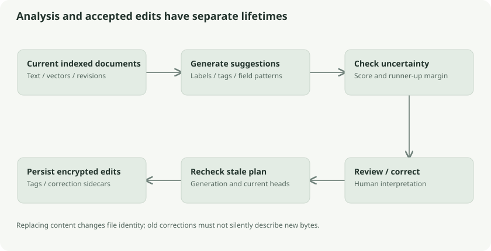

# Category suggestions, field extraction, and corrections

Document analysis builds suggestions from local embeddings and text patterns. It does not use a generative language model to invent a folder plan or silently rewrite metadata. The important engineering boundary is between proposing an interpretation and saving an edit.

## Classification by label similarity

The built-in labels are Identity, Money, Legal, Health, Education, and Work. Each has a natural-language description embedded using the same model. Classification compares document vectors with these label vectors and looks at both the best score and its separation from the runner-up.

The default classification thresholds are cutoff **0.50** and margin **0.01**, selected on the project's public synthetic evaluation. Those are different from search's 0.52/0.90 thresholds. A model can find a relevant search result without establishing a stable category winner.

Consider a document scoring Money=0.62 and Legal=0.615. The difference is 0.005, below a 0.01 margin. Despite a reasonably high best similarity, it is ambiguous. “Invoice attached to a legal settlement” plausibly belongs to multiple topics. The mechanism's uncertainty is appropriate evidence to review, not a reason to convert similarity into a percentage.

## General-purpose field suggestions

`core/semantic/fields.go` extracts bounded date and currency patterns from text and attaches evidence. This is pattern recognition over strings, not a schema-specific guarantee that a particular date is a renewal deadline or that an amount is the payable total.

For example, finding `₹1,250` near bill text can suggest a currency amount. It does not by itself distinguish amount due, previous balance, or tax. A date near “issued” should not be promoted to expiry merely because both are dates. The system exposes generic evidence and permits corrections.

## Corrections as sidecars

Saved corrections become encrypted internal documents tagged `klefki:system:analysis-correction`. They bind the interpreted logical object and content file ID, include confirmed category/fields, and can record resolved correction records. Content identity matters: renaming a PDF should not discard its correction, while replacing the PDF should not automatically reuse analysis for different bytes.

Multiple offline corrections can conflict too. The revision model is not exempt just because the payload is a model-related sidecar. Analysis loaders validate records, identity, and current content before using them.

## Existing and custom tag matching

`SuggestTags` loads the keyword index, semantic index, visible document heads, and correction records. Candidates include built-in labels, existing user tags, and custom tags. A custom tag can have a description embedding and examples drawn from already tagged documents. Confirmed corrections can influence matching.

The source deduplicates candidates case-insensitively, checks reserved/user-tag rules, caps inputs/candidates, and skips conflicting or unsuitable documents. Existing tagged examples are tracked by object identity rather than counting multiple copies of the same owner as independent evidence.

Unmatched documents may be grouped and offered editable new tag suggestions using their semantic/term information. The system remains a suggestion engine; source-derived local clusters do not establish an objectively correct folder taxonomy.

## Stale-plan protection and atomic application

A proposal refers to current revisions and session generation. Applying it after another edit or a lock/unlock cycle must not write to the wrong state. Desktop's organization service checks generation/revisions, and `core/sync/tags.go` applies validated tag changes transactionally.

Think of a librarian marking proposed labels on a review sheet. If the books have changed editions since the sheet was prepared, the librarian rechecks before sticking labels on them. Applying old suggestions without revision checks would be a lost-update bug.

The current organizer focuses on tags and document-purpose evaluation. The roadmap's broader vault/folder organization, local LLM features, and other future items are plans rather than existing capabilities inferred from this code.

## Follow the source

- [Classification and thresholds](../../../core/semantic/semantic.go): `Classify`, `Labels`
- [Field patterns](../../../core/semantic/fields.go): `Fields`
- [Analysis/correction sidecars](../../../core/search/semantic.go): `Analyze`, `SaveCorrection`, `Corrections`
- [Organizer](../../../core/search/organize.go): `SuggestTags`
- [Desktop plan lifecycle](../../../core/desktop/organize.go) and [atomic tags](../../../core/sync/tags.go)
- [Organization implementation record](../../organization.md), [future roadmap](../../../ROADMAP.md)
