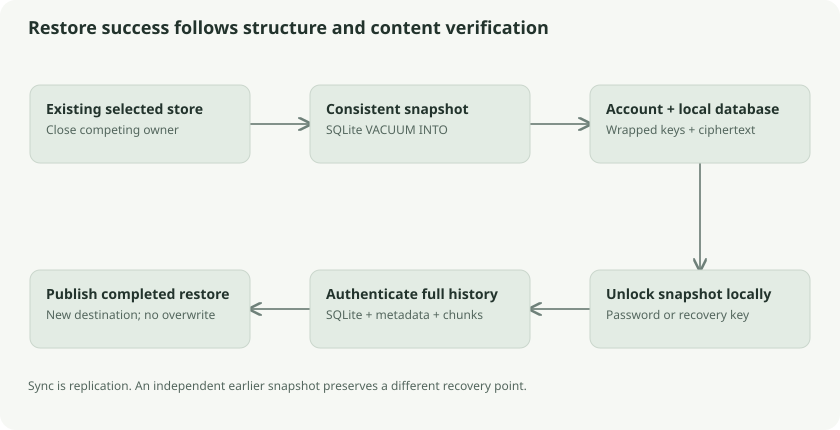

# Backup, restore, integrity checking, and safe export

Sync keeps devices aligned. A backup preserves a chosen local store independently of the server. These differ because deletion, bad edits, and server loss can propagate through replication, while an earlier separate snapshot may preserve recoverable history.



## What a backup contains

The CLI backup directory contains `account.v1` and a consistent `local.db`. The account file contains encrypted master wrappers; the database contains ciphertext, historical revisions, pending edits, folders, conflicts, and local bookkeeping. The random recovery key and unwrapped master key are not intentionally added to that snapshot.

A backup of device A does not include an unsynced edit that exists only on device B. Sync browser changes to a desktop/CLI store before backing them up. A ciphertext snapshot without an unlock route is not usable; a recovery code without the surviving wrapped records/ciphertext cannot recreate lost bytes.

## Snapshotting correctly

`Store.Snapshot` serializes with sync and store operations and uses SQLite `VACUUM INTO` to create a consistent standalone database. It then publishes that file through the private non-overwriting helper. This handles WAL state correctly, unlike copying only a live database's main file.

The CLI opens an existing initialized store and checks account identity; it does not silently create an empty source. Restore rejects backup sources with nonempty WAL/journal state because it expects a completed snapshot rather than a live database.

The analogy is photographing a complete ledger at one instant. Copying random pages while entries are being posted can yield a plausible-looking but incomplete ledger.

## Two integrity layers

`Store.Check` first uses SQLite `PRAGMA integrity_check`. That establishes database-structure integrity, not document authenticity. It then traverses stored revisions in insertion order, validates base ownership, authenticates each metadata/key pair, checks chunk counts, authenticates every chunk, and verifies lengths/final markers.

It also compares expected unique file chunks with all stored chunk rows, so unexplained extras do not pass unnoticed. Metadata-only revisions can refer to the same content file; expected chunks are counted by unique file ID.

This authenticates stored current and historical content, including retained trash. It cannot detect a complete valid branch erased before backup or a rollback to an older complete store. There is no trusted external historical checkpoint to compare with.

## Restore workflow

The restore command unlocks the account from the backup using password or recovery code, creates a new destination, copies the snapshot, opens it as an existing store, and authenticates its contents before reporting completion. On ordinary failure it removes the newly created output directory.

Destinations must not exist. Recovery is a local decryption operation; it does not reset remote authentication or make a new server reconstruct deleted data. Keep the recovery code separate from backups that it can unlock.

## Safe plaintext publication

`local.Publish` creates a private staging file in the destination directory, runs the writer, syncs and closes it, and hard-links it into the final path without overwrite. If authentication or writing fails, the requested final output does not become a partially decrypted file. Existing targets are refused.

Using a hard link makes publication exclusive. A filesystem without suitable hard-link support fails rather than quietly falling back to overwriting. A process crash can leave a private staging file; ordinary cleanup is not a universal crash-erasure guarantee.

`export-plain` deliberately writes plaintext documents and a metadata manifest. It uses opaque revision IDs as output filenames so hostile or colliding decrypted names are not interpreted as filesystem paths. This export includes historical content and trash; its privacy properties differ from encrypted backup.

## Example commands

These are optional commands to run against a chosen local account after closing any desktop process using that store. They are not commands executed while creating this guide.

```sh
go build -o /tmp/klefki ./cli
/tmp/klefki check --klefki /path/to/account.v1
/tmp/klefki backup --klefki /path/to/account.v1 -o /path/to/new-backup
/tmp/klefki restore -o /path/to/new-restored-store /path/to/new-backup
```

## Follow the source and go deeper

- [CLI backup/restore](../../../cli/backup.go): `runBackup`
- [Snapshot and authentication](../../../core/sync/backup.go): `Snapshot`, `Check`
- [Safe file publication](../../../core/local/files.go): `Publish`
- [Existing backup guide](../../backup-restore.md)
- [SQLite VACUUM INTO](https://www.sqlite.org/lang_vacuum.html)
